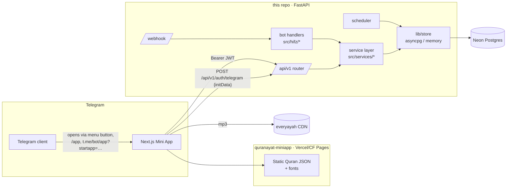
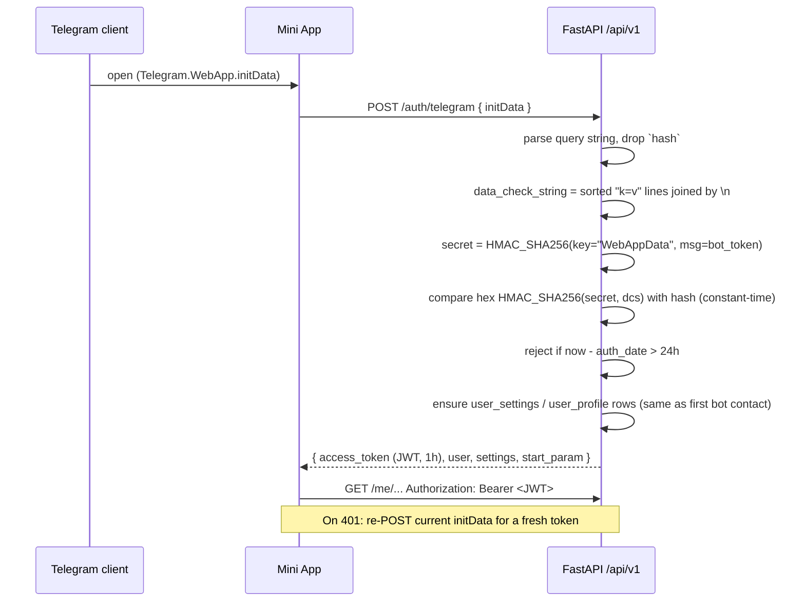

# Telegram Mini App — Implementation Plan

> Bring everything BismillahBot does in chat — reader, page reader, reciters,
> languages, memorization plans, drills, recall checks, progress, streaks,
> leaderboard, profile — into a **Telegram Mini App**, authenticated by
> Telegram itself, backed by API endpoints on the existing FastAPI service.

**Status:** Phase 0 in progress. §11 decisions confirmed 2026-10-20 (see §2, §12).
**Last updated:** 2026-10-20

Same conventions as `docs/HIFZ_PLATFORM.md`: each task has a checkbox, the
files it touches, and a falsifiable **done-when**. Decisions that change mid-build
are amended in §2 and logged in §12, not silently edited.

---

## 1. Scope

### In scope — feature parity map

Every user-facing feature in the bot today, and where it lands.

| Bot feature (today) | Source | Mini App screen | Notes |
|---|---|---|---|
| Ayah reader: translation / tafsir / Arabic / audio, next/prev/random, `surah:ayah` | `src/main.py`, `modules/quran.py` | **Reader** | Arabic as real text with a Qur'an font, not PNG — big readability win |
| Ranges `59:22-24`, stitched range audio | `_download_stitched_audio` | Reader | Client-side **playlist** of per-ayah mp3s, no server stitching |
| `/index` surah list | `modules/quran.py` | **Index** | Search by name/number |
| `/page N` mushaf page (1–604), page audio | `lib/page_image.py`, `pg:`/`pga:` | **Mushaf** | Swipe between pages; page mp3 where `page_audio: true`, playlist fallback |
| `/juz N`, `/sajda` | `modules/quran.py` | Index tabs | Juz list + sajda list |
| `🔁 Repeat ×3` | `rep:` | Reader / Mushaf | Player repeat-N and A–B loop (better than the bot can do) |
| `/reciter` — 79 entries, kinds recitation / riwāyah / translation, warnings, search | `performers.json` | **Settings → Reciter** | Keep kind tabs and the riwāyah/translation warnings verbatim |
| `/language` (48 UI locales), `/translation` (+ transliteration) | `src/locales/*` | Settings | RTL layout driven by the existing `Language.rtl` flag (`src/locales/languages.py`) |
| `/memorize` wizard + preview calendar, pause/resume/abandon | `hifz/memorize.py`, `lib/plan_builder.py` | **Plan** | Multi-step form, calendar view |
| Daily drill + `✅ I know this by heart` | `hifz/memorize.py` | **Today** | Push still comes from the bot, button opens the Mini App |
| `/check` recall quiz | `hifz/check.py`, `lib/recall_check.py` | **Check** | |
| `/progress`, `/forgot` | `hifz/progress.py`, `lib/hifz_progress.py` | **Progress** | Surah grid / juz rings; forgot = select range → unmark |
| `/streak` + 12-week graph | `hifz/streak.py`, `lib/streaks.py` | **Streak** | Graph rendered client-side as SVG, not PNG |
| `/leaderboard` | `hifz/leaderboard.py` | **Leaderboard** | Own rank always shown |
| `/profile` — name, opt-in, UTC offset, reminder time | `hifz/profile.py` | **Profile** | |
| Recitation checker (future) | `docs/RECITATION_CHECKER_INVESTIGATION.md` | **Recite** | Phase 4; record in-app, interactive report |

### Stays in the bot (not ported)

- **Inline mode** (`@BismillahBot 2:255` in any chat) — a bot-only surface.
- **Scheduled pushes** — the scheduler keeps sending; messages gain an
  "Open in app" button.
- **Group cluster** (topic setup, daily group post, group board) — admin setup
  is tied to `my_chat_member` and group context. The Mini App may *display* a
  group board later (Phase 5), not configure it.

### Non-goals

Replacing the chat bot (both surfaces run in parallel, same data) ·
login outside Telegram in v1 · payments · offline mode beyond browser caching ·
native apps.

---

## 2. Decisions (confirmed 2026-10-20)

| Area | Proposal | Why | Alternative considered |
|---|---|---|---|
| **Repo layout** | **Separate repo** `quranayat-miniapp` (Next.js). The API lives **in this repo**, as a new `/api/v1` router on the existing FastAPI app | Business logic (`lib/store`, `plan_builder`, `recall_check`, streaks, scheduler) is Python and already tested — it must not be re-implemented in TypeScript. Separate frontend repo keeps the Python CI and deploy untouched | Next.js API routes talking to Postgres directly → duplicates every rule and breaks the "one storage contract" property (`tests/test_store_contract.py`) |
| **Frontend** | Next.js (App Router, TypeScript), **static export** where possible | Mini App is a client-side app; static hosting is cheap and fast. Server components add little when auth is Telegram-side | Vite + React SPA — equally valid; Next chosen per request and for routing/i18n ecosystem |
| **Hosting** | Frontend on **Vercel**; API stays on Koyeb | Koyeb instance is CPU-bound (0.1 vCPU, `docs/KOYEB_CAPACITY_REPORT.md`) — static assets must not be served from it | — |
| **Telegram SDK** | `@telegram-apps/sdk-react` (pin exact version at Phase 0) | Typed wrappers for theme, viewport, safe areas, BackButton, MainButton, haptics, CloudStorage | `@twa-dev/sdk` (thinner), raw `window.Telegram.WebApp` |
| **Auth** | `initData` validated **server-side** (HMAC-SHA256, key = HMAC("WebAppData", bot_token)) → short-lived **JWT** access token | Standard Telegram flow; user identity = `telegram_user_id`, the key every existing table already uses — **no account linking needed** | Re-sending raw initData on every request (works, but every request re-validates and initData can't be refreshed mid-session) |
| **Quran content delivery** | Static, immutable JSON per surah (Arabic + each translation + tafsir) generated at build time and served from the frontend CDN | Content never changes; 0 API load; cache forever | API endpoints per ayah → pointless load on a 0.1-vCPU box |
| **Audio** | Browser plays everyayah mp3 URLs directly; ranges are a playlist | Removes ffmpeg/stitching from the server path entirely for the Mini App | Proxying through `/media/range.mp3` |
| **Arabic rendering** | Uthmānī text (`translations/ar.txt`, Tanzil) in a KFGQPC Uthmanic Hafs font | Selectable, zoomable, sharp at any size; mushaf page view uses `quran-data.xml` page boundaries | Keep stitched PNGs (heavy, not a facsimile anyway — BUSINESS_LOGIC.md §4) |
| **i18n** | Export the Python locale tables to JSON at build; `next-intl` in the frontend; web-only keys added to `src/locales/en.py` under a `web_` prefix | One source of truth; `scripts/check_locales.py` keeps validating all of it | Separate translation files in the frontend repo → drift |
| **API style** | REST + JSON, OpenAPI generated by FastAPI → TypeScript client generated from it (`openapi-typescript`) | Contract is typed end to end; frontend breaks at build, not in production | tRPC/GraphQL — wrong fit for a Python backend |

---

## 3. Architecture



The key structural change is the **service layer** (§5, Phase 1): today the
business flow of each feature lives inside Telegram handlers that take a `Ctx`
and send messages. Both the bot and the API need the same operations, so the
operations move into `src/services/` and both surfaces become thin adapters.

---

## 4. Authentication

### 4.1 Flow



### 4.2 Rules

- **User id comes only from the verified token**, never from a request body or
  query string. Every `/me/*` route reads `user_id` from the JWT `sub`.
- `initData` max age **24 h** (configurable); JWT lifetime **1 h**, signed with
  a new secret held only by the API (HS256). No refresh tokens — re-exchanging
  the still-valid `initData` *is* the refresh.
- `initDataUnsafe` is used by the frontend for display only (name, language
  hint, theme), never for authorization.
- `start_param` (from `startapp=`) is returned by the auth endpoint so the app
  can route the first screen (`drill_<plan_day_id>`, `page_255`, `rj_<job_id>`,
  `check_67`). Treat it as untrusted input — validate shape, then authorize
  the referenced object against the user.
- First open through the Mini App must create the same rows first contact with
  the bot does (`UserSettings._ensure_row`), with `ui_lang` seeded from
  `initData.user.language_code` via the existing `normalize_lang`.
- The bot token never reaches the frontend. Telegram's Ed25519 third-party
  validation path is **not** needed — we own the bot token server-side.
- Library: implement validation in ~30 lines with `hmac`/`hashlib` (no new
  dependency) or use the `telegram-webapp-auth` PyPI package. Either way,
  tests include a known-good vector, a tampered field, a wrong token, and an
  expired `auth_date`.

### 4.3 Transport

- CORS allow-list = the Mini App origin(s) only; `Authorization` header, no
  cookies (Telegram webviews are inconsistent with third-party cookies).
- Rate limit per `user_id` on writes and on `/auth/telegram` per IP.

---

## 5. API surface (`/api/v1`)

All routes JSON; all except `auth` require `Authorization: Bearer`.
Pagination where lists can grow. Shapes are generated into the frontend from
OpenAPI.

| Method & path | Purpose | Backed by |
|---|---|---|
| `POST /auth/telegram` | initData → JWT, bootstrap payload | new `src/api/auth.py` |
| `GET /me` | profile + settings + active plan summary + streak summary | `store.profiles`, `user_settings` |
| `PATCH /me/settings` | `ui_lang`, `translation_lang`, `reciter` | `UserSettings.set_*` |
| `PATCH /me/profile` | display name, leaderboard opt-in, `timezone` (UTC offset), `reminder_time` | `hifz/profile.py` logic → service |
| `GET /catalog/reciters` | 79 entries with `kind`, bitrate, `page_audio` | `performers.json` |
| `GET /catalog/languages` | UI + translation languages | `locales/languages.py` |
| `GET /reader/position` · `PUT /reader/position` | last `(surah, ayah, type)` — shared with the bot | `File.get_user/save_user` (Redis/memory) |
| `POST /plans/preview` | target + pace + weekdays + start → portions (no write) | `lib/plan_builder.build_plan` |
| `POST /plans` | save plan (retires the previous one), enqueue first push | `hifz/memorize.py` save path → service |
| `GET /plans/active` | plan + days + states | `store.plans` |
| `POST /plans/active/pause` · `/resume` · `/abandon` | lifecycle; pause stops the queue | service |
| `GET /today` | today's portion (or next one) | `store.plans` + local date |
| `POST /drills/{plan_day_id}/complete` | `✅ I know this by heart` → interval + session in one transaction, idempotent | same code path as the bot button |
| `GET /check/question?ref=67` | recall question; **correct index not included** | `lib/recall_check` (deterministic per user/ayah/date) |
| `POST /check/answer` | `{question_token, choice}` → result, session logged on pass | recompute question server-side, compare |
| `GET /progress` · `GET /progress/surah/{n}` | derived percentages, intervals | `lib/hifz_progress` |
| `POST /progress/forget` | `{ref}` → unmark | `hifz/progress.unmark` |
| `GET /streak` | current, longest, milestone, last 84 local dates with sessions | `lib/streaks` |
| `GET /leaderboard?week=current` | top N + own row | `lib/leaderboard` |
| `POST /recitations` · `GET /recitations/{job_id}` | upload recording / poll report (Phase 4) | recitation worker |

**Not API endpoints:** Quran text, translations, tafsir, surah/juz/page
metadata — those are static JSON in the frontend build (§2).

**Recall check integrity:** the bot already makes questions deterministic per
`(user, ayah, date)` "so a retry is not a reroll" (`docs/HIFZ_PLATFORM.md` E1).
The API keeps that: `question_token` is a signed `(surah, ayah, date)` and
`/check/answer` rebuilds the question to score it — the correct answer never
leaves the server before the user answers.

---

## 6. Frontend structure (`quranayat-miniapp`)

```
app/
  layout.tsx            # SDK init, theme → CSS vars, i18n provider, dir=rtl|ltr
  page.tsx              # Home: Today card, streak, continue reading
  read/[surah]/page.tsx # Reader (ayah list, translation/tafsir toggles)
  mushaf/[page]/page.tsx
  index/page.tsx        # Surahs · Juz · Sajda tabs
  plan/page.tsx         # Active plan calendar, lifecycle actions
  plan/new/page.tsx     # Wizard: target → pace → days → time → preview → save
  check/page.tsx
  progress/page.tsx
  streak/page.tsx
  leaderboard/page.tsx
  profile/page.tsx
  settings/{language,translation,reciter}/page.tsx
  recite/[...]          # Phase 4
lib/
  api/                  # generated OpenAPI types + fetch wrapper (JWT, 401 → re-auth)
  telegram/             # SDK hooks: BackButton, MainButton, haptics, safe-area
  audio/                # playlist player, repeat-N, A–B loop, MediaSession
  quran/                # static JSON loaders, ref parsing (port of hifz/refs.py rules)
public/quran/           # generated: surah/{n}.json, translations/{lang}/{n}.json, meta.json
scripts/build-content.ts  # reads this repo's corpora → public/quran
```

**Telegram-native behaviour checklist:** follow `themeParams` (light/dark,
accent); respect `safeAreaInset` + `contentSafeAreaInset`; BackButton on every
non-root screen; MainButton for the primary action of wizards
("Save plan", "I know this by heart"); `HapticFeedback` on correct/incorrect
answers; `disableVerticalSwipes` in the mushaf view so page swipes don't close
the app; `CloudStorage` only for UI conveniences (last tab, font size) —
never for anything the bot also needs to see.

---

## 7. Bot ↔ Mini App integration

- **Menu button:** `setChatMenuButton` → Web App button "📖 Open" for all users.
- **Main Mini App** registered in BotFather so `t.me/<bot>/app?startapp=…`
  deep links work from anywhere — including group posts, where `web_app`
  inline buttons are not allowed.
- **Scheduled drill push** (`hifz/memorize.py`): add an
  `InlineKeyboardButton(web_app=WebAppInfo(url=…?startapp=drill_<id>))` next to
  the existing buttons. The chat drill keeps working unchanged.
- **Verse card / page card:** "Open in app" button with `read_<s>_<a>` /
  `page_<n>`.
- **Group daily post** (`hifz/group.py`): `t.me/<bot>/app?startapp=read_…`
  URL button.
- **`/app` command** added to `BOT_COMMANDS`, so all 48 locales advertise it
  (needs one `cmd_app` key per locale — `scripts/check_locales.py` enforces).
- **State is shared:** a drill completed in the app shows as done when the bot
  pushes tomorrow; reader position is the same key the bot uses.

---

## 8. Phased task breakdown

Legend: ⬜ not started · 🟨 in progress · ✅ done · ⛔ blocked

### Phase 0 — Foundations

- [ ] 🟨 **P0.1 — Create `quranayat-miniapp` repo.** Built 2026-10-20 (Next 16.4,
  `@telegram-apps/sdk-react` 3.3.9, `next-intl` 4.14.9, Node 24); verified in a
  browser against a local API with signed initData + mocked bridge (dark theme,
  first name, ar → RTL). Real-device check from a BotFather test Mini App pending. Next.js + TypeScript +
  ESLint, `@telegram-apps/sdk-react`, `next-intl`, CI (typecheck, lint, build).
  *Done when:* an empty app opened from a BotFather test Mini App shows the
  user's Telegram theme colours and first name.
- [x] **P0.2 — Auth endpoint.** ✅ 2026-10-20 — HS256 JWT hand-rolled (fixed
  header, no new dependency); `GET /me` returns settings + profile (plan/streak
  summary joins in Phase 3). Per-IP rate limit on `/auth/telegram` (§4.3) not
  yet built — tracked as P0.6. `POST /api/v1/auth/telegram`, JWT issuing,
  `require_user` dependency, CORS allow-list, new env vars documented in
  `.env.example` (placeholder names only).
  *Files:* `src/api/__init__.py`, `src/api/auth.py`, `src/main.py` (mount
  router), `.env.example`, `tests/test_api_auth.py`
  *Done when:* tests pass for valid / tampered / wrong-token / expired
  `initData`, and a `/me` call without a token returns 401.
- [x] **P0.3 — OpenAPI → TS client pipeline.** ✅ 2026-10-20 —
  `scripts/export_openapi.py` here (only `/api/v1`); frontend commits
  `api/openapi.json`, generates `lib/api/schema.d.ts`, CI `api:check`; live drift
  check runs when the `OPENAPI_URL` repo variable is set. Script in the frontend repo
  pulls `/openapi.json` and generates types; CI fails on drift.
  *Done when:* changing a response field in Python breaks the frontend build.
- [x] **P0.4 — Static content build.** ✅ 2026-10-20 — Python exporter
  `scripts/export_web_content.py` → `build/web-content/` (gitignored, ~85 MB
  raw); basmalah lifted into a `bismillah` flag; ko 40:81 and ku 108:3 are blank
  in the source corpus (pinned in the test). `scripts/build-content.ts` (or a Python
  exporter in this repo, `scripts/export_web_content.py`) produces per-surah
  JSON for Arabic, all bundled translations, tafsir, plus `meta.json` (surah
  names/lengths, juz/page/sajda boundaries from `quran-data.xml`).
  *Done when:* 6236 ayahs present per language and page boundaries match
  `Quran.page_range` for all 604 pages (asserted in a test).
- [ ] 🟨 **P0.5 — Locale export.** Backend half done 2026-10-20:
  `scripts/export_locales_json.py` (tables pre-resolved like `t()`, plus
  `languages.json` with `rtl`); first 10 `web_*` keys in en/ru/uz/uz-Cyrl,
  excused elsewhere via `locales.PARTIAL_KEY_PREFIXES`. Render check waits on P0.1. `scripts/export_locales_json.py` dumps
  `src/locales/*.py` to JSON; `web_*` keys added to `en.py` with the same
  `check_locales.py` validation.
  *Done when:* the app renders in uz, uz-Cyrl, ru, ar (RTL) with zero English
  fallback on the screens built so far.

- [ ] **P0.6 — Rate limiting** (§4.3): per-IP on `/auth/telegram`, per-user on
  writes. Needs the real client IP from Koyeb's proxy header.

### Phase 1 — Service-layer extraction (this repo, no UI change)

The prerequisite that keeps the bot and the app identical in behaviour.

- [ ] **P1.1 — `src/services/plans.py`.** Preview, save (incl. retiring the old
  plan and enqueueing), pause/resume/abandon, today's portion, complete drill —
  lifted out of `hifz/memorize.py`; handlers call the service.
  *Done when:* `tests/test_hifz_memorize.py` and `tests/test_acceptance.py`
  pass unmodified.
- [ ] **P1.2 — `src/services/profile.py`, `progress.py`, `check.py`,
  `streak.py`, `leaderboard.py`.** Same treatment.
  *Done when:* the full suite passes unmodified and no service imports
  `telegram`.
- [ ] **P1.3 — Source-level guard.** A test asserts `src/services/` never imports
  `telegram` and `src/api/` never contains SQL — mirrors the existing
  "no SQL outside `lib/store`" rule.

### Phase 2 — Reader parity (read-only, low risk, ships first)

- [ ] **P2.1 — Index** (surahs, juz, sajda). *Done when:* every surah/juz/sajda
  in the bot's `/index`, `/juz`, `/sajda` is reachable.
- [ ] **P2.2 — Reader** with translation/tafsir toggles, ref search (`2:255`,
  `59:22-24`, surah name), next/prev/random, position synced via
  `/reader/position`. *Done when:* position set in the app is where the bot's
  next/previous continue from, and vice versa.
- [ ] **P2.3 — Audio player.** Per-ayah, range playlist, page audio with
  playlist fallback for the 19 reciters without page mp3s, repeat ×N, A–B loop,
  background playback via MediaSession. *Done when:* a 3-ayah range plays
  gaplessly enough to drill with, on iOS and Android Telegram.
- [ ] **P2.4 — Mushaf view** 1–604 with swipe, page-of-ayah lookup.
- [ ] **P2.5 — Settings:** language (48), translation (+ transliteration),
  reciter picker with kind tabs, warnings, search.
  *Done when:* changing reciter in the app changes the bot's next audio, and
  `/language` never changes audio (the README guarantee) — tested.
- [ ] **P2.6 — Bot entry points:** menu button, `/app`, "Open in app" on verse
  and page cards. *Done when:* each button lands on the matching screen via
  `start_param`.

### Phase 3 — Hifz parity

- [ ] **P3.1 — Profile** (name, opt-in, offset, reminder). *Done when:*
  changing reminder time in the app moves the next scheduled push.
- [ ] **P3.2 — Plan wizard + preview calendar + lifecycle.** *Done when:* the
  preview equals the saved `plan_day` rows day for day (same
  `build_plan` call), and a plan made in the app is pushed by the bot.
- [ ] **P3.3 — Today / drill + "I know this by heart".** *Done when:* tapping
  in app and in chat for the same day logs one session, not two.
- [ ] **P3.4 — Recall check.** *Done when:* the response for a question never
  contains the correct index, and a pass ticks the streak once per day.
- [ ] **P3.5 — Progress + forgot.** *Done when:* Al-Mulk 67:1–8 shows 27 %,
  then 33 % after 67:5–10 (HIFZ_PLATFORM.md §7 numbers).
- [ ] **P3.6 — Streak (SVG graph) + Leaderboard.** *Done when:* an opted-out
  user is absent from the API response, not just hidden.
- [ ] **P3.7 — Push → app.** Drill push carries a `web_app` button.

### Phase 4 — Recitation checker UI (depends on the investigation's Phase A)

- [ ] **P4.1 — In-app recording** (`MediaRecorder`, Opus/WebM; fallback "send a
  voice note in chat" if mic permission is unavailable in the webview).
- [ ] **P4.2 — Upload + poll** `POST /recitations`, `GET /recitations/{id}`.
- [ ] **P4.3 — Interactive report:** tappable error words, my-audio vs
  reference playback at the error timestamp, attempt history.

### Phase 5 — Later

Group board view (read-only) · offline caching of downloaded surahs (service
worker) · sharing cards · login outside Telegram (Telegram Login Widget).

---

## 9. Testing

- **Backend:** pytest for every `/api/v1` route against both storage legs (in-
  memory + Postgres, as `tests/test_store_contract.py` already does), auth
  vectors, and a bot↔API equivalence test per feature (same action through the
  handler and the route → same rows).
- **Frontend:** unit tests for ref parsing and the player queue; Playwright
  against a mocked `window.Telegram.WebApp` (injected `initData` signed with a
  test token) for the wizard and check flows.
- **Device matrix before each phase ships:** Telegram iOS, Android, Desktop,
  Web K/A — webview differences (audio autoplay, safe areas, mic) are the main
  source of Mini App bugs.

---

## 10. Risks

| Risk | Mitigation |
|---|---|
| Koyeb 0.1 vCPU now serves API traffic too | Static content/audio never hit it; API responses are small reads; re-run `scripts/stress` with an API mix before launch |
| Logic drift between bot and app | Phase 1 service layer + equivalence tests; no business rule in TypeScript beyond formatting |
| iOS webview audio restrictions (no autoplay, background audio) | Start playback only from a user gesture; MediaSession; test on real devices early (P2.3) |
| Arabic font/text vs the images users know | Uthmānī text + KFGQPC font; confirm font licence; keep "view page image" fallback for one release |
| initData replay | `auth_date` max age, short JWT, HTTPS only, user id only from token |
| Translations licences on web distribution | `ATTRIBUTIONS.md` already flags review-before-distribution; a static bundle is distribution — review before Phase 2 ships |
| 48-locale cost of new `web_*` strings | Same policy option as Phase 2 of hifz: en/ru/uz/uz-Cyrl first, others fall back, explicitly recorded |

---

## 11. Decisions (resolved 2026-10-20)

1. **Repo:** separate `quranayat-miniapp` repo; API in this repo.
2. **Frontend hosting:** Vercel.
3. **`web_*` locales at launch:** en/ru/uz/uz-Cyrl; the other 44 fall back to
   English, gap recorded.
4. **Arabic display:** Uthmānī text + KFGQPC font.
5. **Order:** reader parity (Phase 2) before hifz (Phase 3).

---

## 12. Change log

| Date | Change |
|---|---|
| 2026-10-20 | Document created. |
| 2026-10-20 | Real initData carries `signature` (Bot API 8.0); the SDK rejects launch params without it. Test vectors include it. |
| 2026-10-20 | §11 resolved: separate repo, Vercel, 4 launch locales, text+font, reader first. P0.2 done; P0.6 (rate limiting) split out. |

---

## References

- [Telegram Mini Apps — official docs](https://core.telegram.org/bots/webapps) (initData validation, MainButton/BackButton, safe areas, `startapp`)
- [Telegram Mini Apps community docs — init data](https://docs.telegram-mini-apps.com/platform/init-data)
- [`telegram-webapp-auth` (PyPI)](https://pypi.org/project/telegram-webapp-auth/)
- `docs/RECITATION_CHECKER_INVESTIGATION.md` — Phase 4 backend
