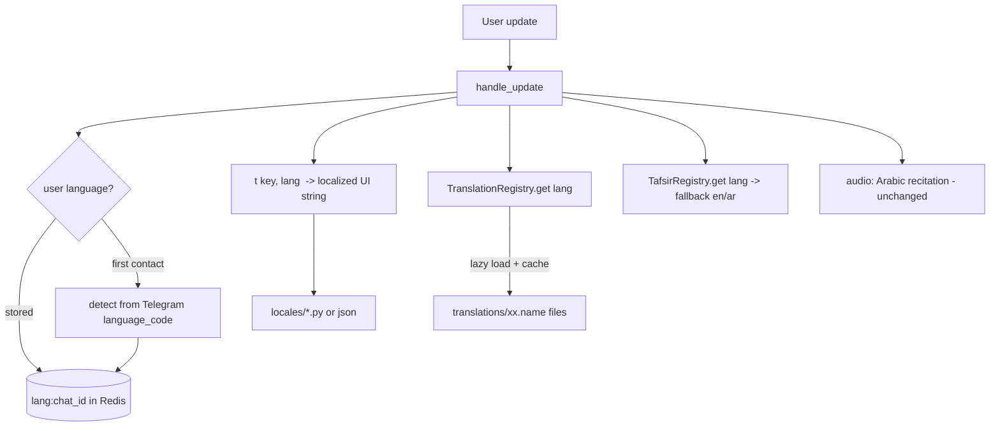
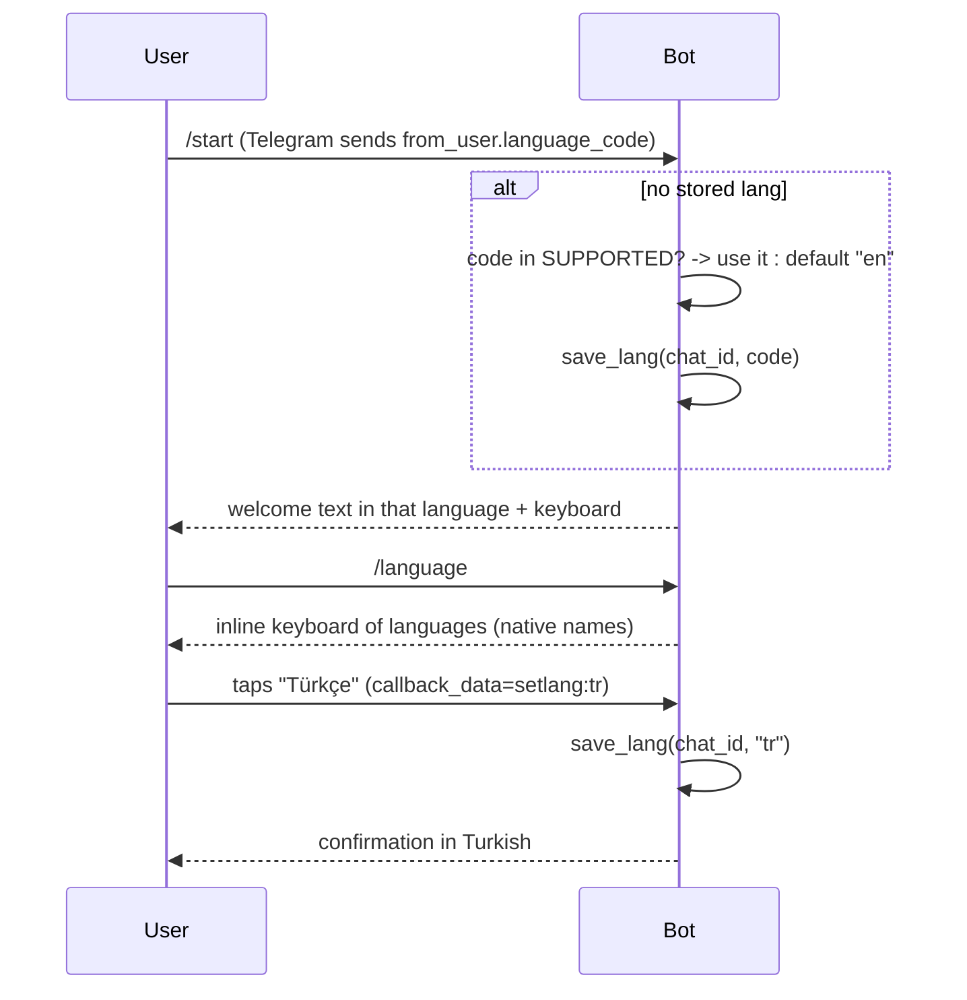

# BismillahBot — Multilingual Support Plan

> Written before the refactor (docs/REFACTOR_PLAN.md): the text names the files as they were then, and the links point to where that code lives now.

> A phased plan to make the bot speak the user's language: both its **interface**
> (menus, help, errors) and its **content** (Qur'an translations, and where
> possible tafsir and translated audio).

---

## 1. Goal & scope

Today the bot is **English-only** in every respect: the UI strings, the single
translation (`en.ahmedraza`), and the tafsir (Tafsir al-Jalalayn, English). The
goal is to let a user pick a language once and have the whole experience follow.

"Multilingual" splits into **four independent dimensions** — they can ship
separately, in the order below:

| # | Dimension | Today | Target | Difficulty |
|---|-----------|-------|--------|------------|
| 1 | **UI language** (menus, `/help`, errors, buttons) | English hardcoded | Localized per user | Low |
| 2 | **Translation content** (the ayah text) | `en.ahmedraza` only | Many languages (Urdu, Turkish, Indonesian, French, Russian, …) | Medium |
| 3 | **Tafsir content** | al-Jalalayn (English) | Multilingual where sources exist; else fall back | High (sourcing) |
| 4 | **Audio** | Arabic recitation (Husary) | Optionally translated recitations | Medium |

Audio note: the **recitation is Arabic and language-independent**, so dimension 4
is optional — but `common/performers.json` already lists translated recitations
(English Sahih Intl, Persian, Urdu, Bosnian, Azerbaijani), so it's low-hanging
fruit later.

---

## 2. Current-state audit (what is hardcoded English)

Everything that must become language-aware, by location:

- **UI strings** in [src/main.py](../src/main.py):
  - `/start` & `/help` text, `/about` text — English prose.
  - Reply keyboard labels: `Arabic`, `Audio`, `English`, `Tafsir`, `Previous`, `Random`, `Next` (in `build_data`).
  - `"Ayah does not exist!"` and the range-too-large message.
  - The button-matching logic (`if message in ("english","tafsir","audio","arabic")`, `("next","previous","random")`) — **matches English words**, so translating the buttons breaks it (see §7).
- **Content loading** in [src/modules/quran.py](../src/domain/quran.py):
  - `Quran("translation")` hardcodes `en.ahmedraza`; `Quran("tafsir")` hardcodes `Al_Jalalain_Eng.txt`.
  - `surah_names` uses the `tname` (transliteration) attribute from `quran-data.xml` — note that file **also has `name` (Arabic) and `ename` (English)**, so localized surah names are partly free.
- **User state** in [src/lib/utils.py](../src/services/user_settings.py):
  - `save_user(chat_id, (surah, ayah, type))` — **no language field**.
- **Inline queries** in [src/main.py](../src/main.py): always return English + Tafsir.
- **Telegram command menu**: not set per-language (`setMyCommands` unused).

---

## 3. Target architecture



Three new pieces, each small and isolated:

1. **`locales/`** — UI string tables per language + a `t(key, lang)` helper.
2. **`TranslationRegistry`** — lazy-loads Qur'an translations on first use, keyed by language, cached in memory.
3. **Language preference** — stored per user, detected on first contact, changed via `/language`.

---

## 4. User language preference

### Storage
Store language **separately** from navigation state, because it is a durable
preference while `(surah, ayah, type)` resets after 2 days:

| Key | Value | TTL |
|-----|-------|-----|
| `lang:{chat_id}` | ISO-639-1 code (`en`, `ur`, `tr`, …) | none / long |
| `{chat_id}` (existing) | `[surah, ayah, type]` | 2 days (unchanged) |

New helpers in [src/lib/utils.py](../src/services/user_settings.py): `save_lang(chat_id, code)` /
`get_lang(chat_id)`. (Both work with the in-memory fallback store already in place.)

### Detection & selection flow



- **Auto-detect** from `update.message.from_user.language_code` (Telegram sends
  e.g. `tr`, `ur`, `en-US`). Take the primary subtag, use it if supported, else `en`.
- **`/language` command** → inline keyboard (native names, e.g. `اردو`, `Türkçe`,
  `Bahasa Indonesia`) with `callback_data = "setlang:<code>"`.
- Requires a **`CallbackQueryHandler`** — currently the app only handles messages
  and inline queries, so add `update.callback_query` handling in `handle_update`.

---

## 5. Content: multi-translation loading (memory-aware)

The free Koyeb instance is **512 MB and ~0.1 vCPU**, so we must **not** parse every
translation at startup. Design a **lazy registry**:

```python
class TranslationRegistry:
    """Loads and caches Qur'an translations on demand, one per language."""
    _cache: dict[str, Quran] = {}

    @classmethod
    def get(cls, lang: str) -> Quran:
        if lang not in cls._cache:
            spec = TRANSLATIONS.get(lang, TRANSLATIONS["en"])  # fallback
            cls._cache[lang] = Quran.from_file(spec.path)      # parse once
        return cls._cache[lang]
```

- **Only English is preloaded** (in `build_data`); every other language is parsed
  on first request and then cached — startup stays fast, memory grows only with
  languages actually used.
- Each translation file is ~1–2 MB of text (~6236 verses); a handful cached is
  well within budget. If memory ever tightens, add a simple LRU cap.
- Refactor `Quran.__init__` into a `Quran.from_file(path)` classmethod so it isn't
  tied to the three hardcoded names.

### Translation catalogue (initial set)
Sourced from **tanzil.net** (same `surah|ayah|text` format the existing
`parse_quran` already reads):

| Lang | Code | Suggested tanzil file | RTL |
|------|------|-----------------------|-----|
| English | `en` | `en.ahmedraza` (have) / `en.sahih` | no |
| Arabic (original) | `ar` | `quran-simple` / images | RTL |
| Urdu | `ur` | `ur.jalandhry` | RTL |
| Turkish | `tr` | `tr.diyanet` | no |
| Indonesian | `id` | `id.indonesian` | no |
| French | `fr` | `fr.hamidullah` | no |
| Russian | `ru` | `ru.kuliev` | no |
| Bengali | `bn` | `bn.bengali` | no |
| Persian | `fa` | `fa.makarem` | RTL |
| Hindi | `hi` | `hi.farooq` | no |

RTL text (Arabic/Urdu/Persian) renders correctly in Telegram automatically — no
special handling needed.

> **Licensing:** tanzil.net translations each carry their own terms. Before
> bundling, record each translation's license/attribution in an `ATTRIBUTIONS.md`
> and surface it in `/about`. This is a **release blocker**, not an afterthought.

---

## 6. UI internationalization (i18n)

Keep it dependency-free and simple — a dict of dicts:

```
src/locales/
  __init__.py     # t(key, lang) -> str, with English fallback
  en.py           # {"welcome": "...", "btn_translation": "Translation", ...}
  tr.py
  ur.py
  ...
```

```python
def t(key: str, lang: str) -> str:
    return LOCALES.get(lang, LOCALES["en"]).get(key) or LOCALES["en"][key]
```

- Every user-facing string in `handle_update` becomes `t("key", lang)`.
- **Missing keys fall back to English**, so a partially-translated language still works.
- Keep keys stable and few: `welcome`, `help`, `about`, `ayah_not_found`,
  `range_too_large`, `choose_language`, `language_set`, plus button labels.

---

## 7. The keyboard & command localization challenge

**The hard part.** The reply keyboard is matched by **English text**:
`if message in ("english","tafsir","audio","arabic")`. If we localize the button
labels, incoming button text will be e.g. `"Tercüme"` (Turkish) and won't match.

Two options:

- **Option A — reverse-map localized labels → action (smaller change).**
  Build the keyboard with `t()` labels, and maintain a per-language
  `{localized_label_lower: action}` map to translate taps back to canonical
  actions (`translation`, `tafsir`, `arabic`, `audio`, `next`, `previous`, `random`).
  Keeps the existing reply-keyboard UX.

- **Option B — switch content/nav buttons to inline keyboards with `callback_data` (cleaner, bigger change).**
  `callback_data` is language-independent (`act:next`, `act:translation`), so no
  reverse mapping is ever needed. Requires the `CallbackQueryHandler` we already
  need for `/language`, and reworks how the current reply keyboard is presented.

**Recommendation:** Option A for v1 (least disruption), migrate to Option B later.

Also relabel the content buttons conceptually: **`English` → `Translation`** (in
the user's language), since it's no longer always English. `Arabic` (image),
`Audio`, `Tafsir` stay as concepts.

### Telegram command menu
Localize the slash-command menu with **`setMyCommands(commands, language_code=…)`**
once per supported language at startup (alongside `set_webhook`). Add a
`/language` command entry.

---

## 8. Tafsir & audio (later dimensions)

- **Tafsir:** al-Jalalayn exists mainly in Arabic and English. Multilingual tafsir
  sources are scarce, so: keep tafsir **English (or Arabic) with a clear fallback
  note** in v1; add other languages only where a clean source exists. Model it with
  a `TafsirRegistry` mirroring the translation one, but with **fallback to `en`**
  when the user's language has no tafsir.
- **Audio:** offer translated recitations from the existing `performers.json`
  (English Sahih Intl, Persian, Urdu). Add a per-user "reciter/audio language"
  preference. Purely additive — the Arabic Husary default stays.

### 8.1 Uzbek translated audio (newbooks.uz mirror) — planned, not built

An Uzbek audio translation of the whole Qur'an, one mp3 per surah. The recordings
circulate openly in Telegram channels; newbooks.uz is just a server mirror that
developers can fetch from. Goal: Uzbek users (`uz`, `uz-Cyrl`) can **play,
download and share** it in the bot and the Mini App, for a whole surah **and for a
single ayah**.

**Hard rule: we never store the audio.** Not on disk, not in Postgres/Redis, not
on a CDN of ours. What we keep:
- Telegram `file_id`s in `media_cache`, which point at Telegram's copy.
- A small timing table (§8.1.3), which is our own data, not audio.

Bytes **may** pass through process RAM transiently while being uploaded to
Telegram, and are then discarded (§8.1.4). Confirmed by the owner on 2026-11-08:
in-memory transit is allowed; writing to disk or any store is not.

#### 8.1.1 Source (probed 2026-11-08)

| What | URL pattern | Notes |
|---|---|---|
| Player page | `https://newbooks.uz/ms.php?t=NNN` | `NNN` = surah 001–114, zero-padded. Title "<Surah> surasi tarjimasi" in Uzbek Latin |
| Audio | `https://newbooks.uz/audio/t1/NNN.mp3` | All 114 present, ≈1.6 GB, ≈11 h total. The page links `http://`, which 301s to `https://`. Always use `https://` |
| Same site | `ms.php?m=001…073` → `audio/books/muallimi-soniy/*.mp3` | *Muallimi soniy* tajweed primer, 73 lessons. Input for a future tajvid section |
| Unlisted | `audio/q1/NNN.mp3` | 114 files, smaller (Baqara 58 MB). Probably Arabic recitation. Unverified, not used |

No index, sitemap, robots.txt or directory listing exists. `ms.php` reads only `m`
and `t`.

**Format facts that make ayah-level work cheap:**
- **Constant bitrate within each file, but the bitrate differs between files.** MPEG-1 Layer III, 32 kHz, no Xing/VBRI/ID3 header. Measured: 001 = 320 kbps, 002 = 96, 003 = 128, 073 = 96, 114 = 96 (Baqara is therefore 2 h 33 m, not 46 min). Every frame is 1152 samples = 36 ms and `4.5 × kbps` bytes (96 kbps → 432 B, 320 kbps → 1440 B). So **byte offset = seconds × kbps × 125**, aligned down to a frame boundary. The per-surah `kbps` is stored in the timings JSON (§8.1.3). Read it from the first frame header once and don't assume it. (Verified frame by frame: 001.mp3 is 2524 frames all at 320 kbps; the last 24 MB of 002.mp3 is 55 556 frames all at 96 kbps.)
- **HTTP Range is supported** (`206 Partial Content`). Any time span is one Range request, a self-contained playable MP3 slice: no decoding, no ffmpeg, no re-encoding.
- **No CORS headers.** That's fine for `<audio src>` playback and seeking. It blocks `fetch()`/WebAudio from the browser, so the Mini App must not need them.

#### 8.1.2 Whole-surah playback and download

**Mini App:** `<audio src="https://newbooks.uz/audio/t1/NNN.mp3">` streams
straight from newbooks.uz. Seeking uses Range. There is no size limit and our API
isn't involved. Download uses `Telegram.WebApp.downloadFile({url, file_name})`
(Bot API 8.0+), which shows Telegram's native save dialog, plus a "Send to chat"
button that asks the bot to send the audio message.

**Bot:** a `🎧 Tarjima (audio)` button on the surah index entry and on verse cards
for `uz`/`uz-Cyrl` users. Telegram audio messages are playable and downloadable
in every client, so download needs nothing extra. Cache key `nbt:<surah>` (or
`nbt:<surah>:p<k>` for parts).

Bot API limits: Telegram fetches a URL itself only up to **20 MB**. Multipart
upload is capped at **50 MB**.

| Size | Surahs | Delivery |
|---|---|---|
| ≤ 20 MB | 88 | `sendAudio(audio=<https url>)`. Telegram pulls the file and no byte touches Koyeb |
| 20–50 MB | 19 (8, 10, 11, 13, 14, 18–24, 26–29, 33, 39, 40) | Sent as **parts ≤ 20 MB** (8–28 min each, depending on bitrate), cut by Range at frame boundaries and uploaded |
| > 50 MB | 7 (2, 3, 4, 5, 6, 7, 9; Baqara 105 MB → 6 parts) | Same: parts ≤ 20 MB |

Parts are sent as one `sendMediaGroup` of audios (up to 10 per group), titled
"Baqara — 1/6 (1–48)". When the §8.1.3 timings exist, part boundaries snap to an
ayah boundary, so no part starts mid-ayah.

#### 8.1.3 Ayah-level: the timing table

Pointing at one ayah needs `(surah, ayah) → (start_s, end_s)` inside the surah
file. Nobody publishes this, so we produce it once, offline:

- **Output:** `data/nb_t1_timings.json`, about 6236 × 2 numbers (≈150 KB). It is committed, and all ayah features read it.
- **How:** a one-off script run on a laptop or Colab, never on Koyeb. It downloads each surah to a temp dir, aligns, writes timings, and deletes the audio.
  - **If the narration is our Uzbek text** (`uz.sodik`, Muhammad Sodiq): forced alignment of the text against the audio. Use a CTC aligner with an Uzbek acoustic model (`ctc-forced-aligner` / MMS, which covers `uzb`), or Whisper `large-v3` word timestamps matched to ayah text. This is the most accurate path.
  - **If it's a different translator:** Whisper transcription with word timestamps, then fuzzy-align the transcript to ayah boundaries using pauses plus ayah numbers if the narrator reads them. Lower confidence, so it needs more review.
  - **If each ayah is Arabic followed by Uzbek:** the Arabic recitation and pauses give strong boundaries. An Arabic CTC model can find the Arabic segments.
- **Quality gate:** segment count equals the surah's ayah count, segments are monotonic with no gaps over 3 s, and someone listens to a sample of ~3 ayat per surah (start, middle, end). Surahs that fail stay surah-only (§8.1.2) until fixed. Per-surah `verified: true` flags in the JSON switch ayah features on.

**Worked example, measured 2026-11-08 (002.mp3, 96 kbps → 432-byte frames, 36 ms each):**

| Clip | Time in file | Range header | Size |
|---|---|---|---|
| 2:284 | 9034.1–9067.4 s (2:30:34–2:31:07) | `bytes=108409104-108808703` | 390 KB, 33.3 s |
| 2:284–285 | 9034.1–9114.2 s (2:30:34–2:31:54) | `bytes=108409104-109370303` | 939 KB, 80.1 s |

Found with Whisper `small` (transcript and word timestamps) plus an energy-based
pause detector. Each cut sits in a ≥ 0.6 s pause, and both sides of every cut
were re-transcribed to confirm them. For example, after the 2:284→285 cut the
audio begins "Payg‘ambar Muhammad o‘ziga Parvardigoridan nozil qilingan…". The
Range slices play as-is (925 and 2225 whole frames).

What this sample showed about the source:
- **Uzbek narration only.** No Arabic recitation, and ayah numbers aren't read aloud.
- **It is not the Muhammad Sodiq text we bundle.** 2:284 is narrated as "…Sungra o‘zi xohlagan kishini mag‘firat qilib…" and has no bracketed commentary. Forced alignment against `uz.txt` is therefore not possible. Use the "different translator" path above: transcript plus pauses, matched to ayah boundaries. A transcript-to-ayah matcher can lean on the Sodiq text as a fuzzy guide, since the meaning and many words overlap.

#### 8.1.4 Ayah-level playback and download

**Mini App** (no server work): seek the surah `<audio>` to `start_s` and pause on
`timeupdate ≥ end_s`. Range makes the seek instant. Add an ayah-repeat loop
(A–B, plugs into the planned Reader repeat), and highlight the playing ayah while
the whole surah plays, auto-scrolling the Reader (karaoke-style). Download of one
ayah goes through "Send to chat".

**Bot:** `🎧 Tarjima` on a verse card sends **that ayah only**:
1. Look up `nbt:<s>:<a>` in `media_cache`. On a hit, send the `file_id`.
2. On a miss, make one Range request for `[start, end)` (typically 0.1–3 MB, depending on the surah's bitrate), upload it with `sendAudio` (title "2:255 — tarjima"), cache the `file_id`, and drop the bytes. No disk write, and each ayah passes through once ever.
3. Ranges (`2:255-257`) are a single contiguous Range, because consecutive ayat are adjacent in the file. That's simpler than the Arabic stitched-range path.
4. Bound concurrency, as `_download_stitched_audio` already does. Slices are small, so RAM is fine on 512 MB.

Optional warm-up: a script run **locally** (not on Koyeb) uploads every surah part
and ayah slice to a private channel and records the `file_id`s, so the live server
never transits a byte. ~6.3k uploads, rate-limited, so it runs for hours. Only do
it if on-demand slicing shows load issues.

#### 8.1.5 Fit with the existing model

- This is **not** a `performers.json` entry. That catalog is everyayah's one-file-per-ayah layout. It's a separate source module (`infra/nb_audio.py`: URL builder, Range slicer, timing lookup).
- It does **not** change the reciter. "Audio never follows language" (`BUSINESS_LOGIC.md` § Audio catalog kinds, `tests/test_reciter_picker.py`) still holds: this is an extra button beside the recitation, shown only to `uz`/`uz-Cyrl`.
- WhatsApp: whole surahs via cached media id (parts ≤ 16 MB, the WhatsApp audio cap) and ayah slices the same way. Later; not in the first cut.
- Attribution: identify the translator and narrator (the files carry no tags). Record them in `ATTRIBUTIONS.md` and the audio caption. Credit the newbooks.uz mirror as the source.

#### 8.1.6 Open questions

1. ~~What is in the audio?~~ **Partly resolved 2026-11-08:** Uzbek only, not the Sodiq text (worked example, §8.1.3). The translator's name is still unknown and is needed for attribution.
2. ~~Is transient in-RAM transit acceptable?~~ **Resolved 2026-11-08: yes.** On-demand slicing on Koyeb is the default. The local warm-up script is optional.
3. Dependency on a third-party mirror: if newbooks.uz goes down, URL sends and Mini App playback stop, but cached `file_id`s keep working. Optionally pre-warm all surah parts so the bot survives an outage.

#### 8.1.7 Decisions (2026-11-08)

| Topic | Decision |
|---|---|
| Who sees it | UI language `uz` or `uz-Cyrl` only. Other users' keyboards stay as they are |
| Scope of this round | Telegram bot and Mini App. WhatsApp later |
| Surahs whose timings fail the quality gate | The whole-surah button always works. Ayah and range clips are still offered, with the caption marked "⏱ taxminiy" (approximate) until the surah is verified |
| Branch | `feat/uz-translation-audio` (bot) and the same name in `quranayat-miniapp` |
| Storage | Telegram `file_id`s and the timing table only. Audio passes through RAM, never disk |

#### 8.1.8 Timing table: format and download formula

`data/uz_audio_timings.json` (committed, ≈150 KB), generated by `scripts/uz_audio/`:

```json
{
  "version": 1,
  "source": "https://newbooks.uz/audio/t1/%03d.mp3",
  "surahs": {
    "2": {
      "kbps": 96, "sample_rate": 32000, "frame_bytes": 432,
      "frames": 254970, "size": 110147040,
      "status": "verified | estimated",
      "ayahs": [[start_frame, end_frame, confidence], ...]
    }
  }
}
```

Frames, not seconds, are stored, so the byte math is exact integers:

```
frame_seconds = 1152 / sample_rate                      # 0.036 s at 32 kHz
ayah a        = ayahs[a-1]  ->  [start_frame, end_frame)   (end exclusive)
range a..b    = [ayahs[a-1][0], ayahs[b-1][1])
HTTP header   = Range: bytes=<start_frame*frame_bytes>-<end_frame*frame_bytes - 1>
seconds       = frame * frame_seconds                   # what the Mini App seeks to
```

Ayah `a`'s `end_frame` equals ayah `a+1`'s `start_frame`, so consecutive clips
join with no gap and no overlap. Anything before ayah 1 (surah title, basmala
spoken as an intro) and after the last ayah belongs to no clip. It is still in
the whole-surah file.

Whole-surah **parts** (files > 20 MB) are derived, not stored. Walk the ayahs
greedily and start a new part before the one that would push the part past
19.5 MB. Part `k` = `[first ayah's start_frame, last ayah's end_frame)`. Part 1
starts at frame 0 and the last part ends at `frames`, so nothing is lost.

`data/uz_audio_overrides.json` (committed, hand-edited) holds human fixes in
seconds. Export applies it on top of the automatic result, so a re-run of the
pipeline never loses a manual correction:

```json
{
  "2:284": {"start": 9034.1},
  "2:285": {"end": 9114.2},
  "verified": {"2": "listened 2:280-286, 2026-11-08"}
}
```

Changing a boundary moves the neighbour's matching edge too. `verified` flips a
surah's status to `verified`.

#### 8.1.9 How the timings are generated (`scripts/uz_audio/`)

Offline, on Apple Silicon (`pip install -r scripts/uz_audio/requirements.txt`).
Audio is cached in `~/.cache/quranayat/uz_audio/` (`UZ_AUDIO_CACHE`), outside the
repo.

| Stage | Command | Output (cache unless noted) |
|---|---|---|
| 0. Fetch | `curl` loop / `fetch` | `mp3/NNN.mp3`, all 114 |
| 1. Transcribe | `python3 -m scripts.uz_audio.transcribe [S…] [--force]` | `transcripts/NNN.json` (Whisper large-v3-turbo via MLX, word timestamps, ~6.6× real time on an M1) and `energy/NNN.npy` (20 ms RMS dB) |
| 2. Align | `python3 -m scripts.uz_audio.align [S…]` | `align/NNN.json`: boundaries and per-boundary evidence |
| 3. Export | `python3 -m scripts.uz_audio.export` | **repo** `data/uz_audio_timings.json` (applies overrides, runs the gates) |

**Alignment (stage 2).** The narration is a different translation from our
`uz.txt` (§8.1.3), so text can guide but not anchor the cuts:
1. **Pauses → chunks.** Stretches below the surah's noise floor + 6 dB, lasting ≥ 0.25 s, split speech into chunks. Every ayah boundary must fall inside a pause.
2. **Similarity.** Each chunk's Whisper text is compared with each nearby ayah's reference text (commentary in `(…)` removed, both normalised: lowercase, Latin, apostrophes and diacritics folded, Turkish-looking spellings mapped). The score is character-trigram overlap.
3. **Dynamic programming.** Chunks are segmented into `N` ayahs plus an optional intro, maximising text similarity, pause length at each cut, and how well each ayah's duration fits its reference length × the surah's speaking rate. Whisper segment starts get a bonus, because they landed within 0.3 s of the true cuts in the worked example.
4. **Cut point.** Each boundary is placed 0.15 s before the next ayah's speech onset, inside the pause, then snapped down to a frame.
5. **Confidence per boundary** comes from pause length, the margin of the chosen cut over the runner-up, and similarity on both sides. It is stored as the third number of each ayah's triple.

**Quality gate (stage 3; a surah failing any check is `estimated`):**
- `len(ayahs) == ayah count`, frames strictly increasing, contiguous, and inside `[0, frames]`.
- Every cut sits in a pause ≥ 0.25 s.
- No ayah is shorter than 0.8 s, and each ayah's duration is within ×3 of its length-based expectation.
- Minimum boundary confidence ≥ 0.5.
- Only a human `verified` entry in overrides makes a surah `verified`.

#### 8.1.10 Testing and debugging wrong timings

**Automated (CI, no network)**, `tests/test_uz_audio_timings.py`:
- The committed JSON passes the structural gate above for all 114 surahs: 6236 ayahs, contiguous, monotonic.
- Byte math: for each surah, `ayahs[-1][1] * frame_bytes <= size`, and the Range header for `2:284` equals `bytes=108409104-108808703` (the worked example, pinned).
- Parts: every part ≤ 19.5 MB, parts cover `[0, frames)` with no gap, and parts start at ayah starts.
- Bot: the keyboard shows the row only for `uz`/`uz-Cyrl`, callbacks send with the right cache key and title, a cache hit makes no HTTP call, the "taxminiy" caption appears for `estimated`, and the Range fetch is mocked to check the header and reject a short or garbled response.

**Live smoke test (manual, network)**: `python3 -m scripts.uz_audio.debug smoke`
fetches 2 bytes at each surah's first and last ayah boundary. It checks that the
server still returns `206`, the same `Content-Length`, and an MPEG frame header
at every boundary. If newbooks.uz ever re-encodes a file, this fails before
users hear garbage.

**Debugging a reported wrong ayah**, e.g. "2:255 starts mid-word":
1. `python3 -m scripts.uz_audio.debug show 2:255` prints the stored start/end (s, frame, byte range), the confidence, the surah status, any override, the pauses within ±5 s of each cut, and the Whisper words around each cut with a `|` at the cut and the reference text.
2. `python3 -m scripts.uz_audio.debug clip 2:255 --pad 3` writes `audio-samples/2-255.mp3` (folder excluded via `.git/info/exclude`). Listen; `--pad` adds 3 s of context on each side, and the printout from step 1 gives the exact cut times inside it. `--server` slices from newbooks.uz by Range instead of the local cache, which is exactly what the bot sends.
3. Fix: `python3 -m scripts.uz_audio.debug set 2:255 start 1234.5`, or `nudge 2:255 start +0.4`, writes `data/uz_audio_overrides.json`. Then `python3 -m scripts.uz_audio.export` and re-clip to confirm.
4. If a whole surah is off (drift, everything shifted), look at `debug report 2`, which lists every boundary sorted by confidence. Usually one missed or extra cut early on shifts the rest. Override that one boundary and re-run `align 2 && export`, so the dynamic programming re-fits around the pinned cut. Overrides act as hard constraints in the dynamic programming, not just a patch afterwards.
5. After the fix, users still get the old clip from Telegram's `file_id` cache. `debug purge 2:255` prints the `media_cache` keys to delete (`uzt:2:255-255`, and any range or part covering it), and the bot also keys the cache by a hash of the timing file's version, so a re-export invalidates changed surahs automatically.
6. Mark it reviewed: add the surah to `verified` in overrides once listened.

`debug report` with no argument gives the triage list for all surahs: status,
minimum confidence, and the count of boundaries under 0.5.

#### 8.1.11 Implementation (this round)

**Bot repo:**
- `src/infra/uz_audio.py`: lazy-loads the timing table; `available(surah)`, `status(surah)`, `byte_range(s, a, b)`, `parts(s)`, `url(s)`, and an async `fetch(s, start_byte, end_byte) -> BytesIO`. It sends an httpx Range request and checks for `206`, an exact length, and a frame sync at byte 0. Fetches are bounded by a semaphore. Nothing is written to disk.
- `src/bot/features/uz_audio.py`: callbacks `uza:S:A` (one ayah), `uzr:S:A:B` (range, ≤ `MAX_RANGE_AYAHS`), `uzs:S` (whole surah: URL send if ≤ 20 MB, otherwise parts as a media group with titles like "Baqara — 1/6 (1–48)"). All go through `send_cached`. Cache key `uzt:<ver>:S:A-B` / `uzt:<ver>:S:p<k>` / `uzt:<ver>:S`, where `<ver>` is the surah's timing hash.
- Verse card: for `uz`/`uz-Cyrl`, one extra row `[🎧 Tarjima] [📚 Sura tarjimasi]`. A typed range (`2:284-285`) for those users gets a `🎧 Tarjima 2:284-285` button under the Arabic range audio.
- Locale keys in `en` (fallback), `uz` and `uz-Cyrl`.
- `scripts/export_web_content.py` also writes `uz-audio/NNN.json` (seconds per ayah + URL) for the Mini App.
- API `POST /api/v1/uz-audio/send {surah, start, end}` lets the Mini App ask the bot to send that clip to the user's chat, for downloading one ayah or a range. It reuses the same feature function.

**Mini App repo:**
- `Track` gains optional `start`/`end` (seconds). The player seeks instead of reloading when `src` doesn't change, and advances on `timeupdate ≥ end`. One ayah, a range and the whole surah are then all just queues of segments over one URL. The highlighted ayah is the current track.
- Reader, for `uz`/`uz-Cyrl`: a "🎧 Tarjima" toggle that plays translation segments instead of recitation, plays the whole surah with the current ayah highlighted, downloads the whole surah through `WebApp.downloadFile` (newbooks URL), and offers "Send to chat" for an ayah or range through the API above. An `estimated` surah shows a small "taxminiy" badge.

#### 8.1.11a Results of the first full run (2026-11-09)

Transcribed on a Colab T4 with large-v3-turbo via faster-whisper. Section 4 of the notebook chose
it with a mean cut error of 0.28 s on the approved al-Baqarah cuts, against 0.41 s for large-v3 and
8.67 s for an Uzbek fine-tune. It ran at about 27× real time, so all 33.8 h took about 75 min.
Align and export ran locally in about 3 min and 61 MB of RAM.

- **110 surahs, 5855 ayahs** are in `data/uz_audio_timings.json` and `data/uz_audio_manifest.csv`. All are `estimated`; 681 boundaries have confidence < 0.5 and are the first to listen to (`debug report`).
- **al-Baqarah check:** 2:284 starts at 9034.13 s (approved 9034.1). The 284|285 cut is at 9067.97 s, inside the measured pause 9066.6–9068.2 (approved mid-pause 9067.4). 285|286 is at 9114.37 s (approved 9114.2).
- **Excluded, because the source file is only part of the surah:** 12 (starts at about 12:75), 16 (only about 119–128), 17 (only about 105–111) and 76 (starts at about 76:6). See `INCOMPLETE_SOURCE` in `scripts/uz_audio/common.py`. The bot shows no Uzbek audio for these until complete recordings are found; newbooks.uz has no other parts under other file names.
- **Fixes the run needed** (all in the repo):
  - the CUDA 12 libraries on Colab;
  - chunked transcription (al-Baqarah in one call ran out of RAM);
  - a pause-based unit split as a fallback, when Whisper merges two ayahs into one segment (1:3–4);
  - rejecting a false basmala match that leaves fewer units than ayahs (84);
  - a minimum ayah length of 0.8 s (10:27 came out 0 s);
  - the Uzbek row made Telegram-only (`verse_keyboard(..., uz_audio=True)`), because the row broke WhatsApp verse cards.

#### 8.1.12 Cost of hosting the audio ourselves (estimate, 2026-11-08)

Today nothing is hosted: clips are byte ranges of the newbooks.uz files, and only Telegram
`file_id`s and the timing table are kept (§8.1.7). This section prices the alternative in case
newbooks.uz goes away or proves too slow. **Not decided. Hosting would reverse the "never store the
audio" decision.**

**Size.** All 6236 ayah clips together are about 1.6 GB, the same bytes as the 114 surah files
(33.8 h of audio). An average ayah is about 20 s, or about 250 KB (Baqara ayahs at 96 kbps average
about 385 KB). Keeping per-ayah files *and* the whole surahs would double storage to about 3.2 GB.

**What drives the cost is the Mini App, not the bot.**
- **Bot:** each clip is uploaded to Telegram once and then replayed by `file_id`. Egress is about 1.6 GB once, then about 0 a month, whatever the number of users.
- **Mini App:** streams from the host on every play. Assumption: 100 ayah plays plus 2 whole surahs (about 14 MB average) per user per month, about 53 MB per user.

| Monthly Mini App users | Egress | Koyeb (volume + egress) | Cloudflare R2 | Backblaze B2 alone |
|---|---|---|---|---|
| 1,000 | ~53 GB | ~$0.25 | $0 | ~$0.50 |
| 10,000 | ~530 GB | ~$17 | $0 | ~$5 |
| 100,000 | ~5.3 TB | ~$210 | ~$1.50 | ~$53 |

Prices used (looked up 2026-11-08):
- **Koyeb:** volume storage $0.15/GB-month. Egress has 100 GB free a month, then $0.04/GB (the rate in §11.1 of `RECITATION_CHECKER_INVESTIGATION.md`; an aggregator lists $0.02). Koyeb would also have to *serve* the files. The free 0.1 vCPU instance can't at this volume, so add at least the "small" instance at $10.71/month.
- **Cloudflare R2:** storage $0.015/GB-month with 10 GB free, so $0 here. Egress is always free. Reads are free up to 10 M a month, then $0.36 per million.
- **Backblaze B2:** 10 GB of storage free. Free egress is only 3× what is stored (about 4.8 GB), then $0.01/GB. Egress through Cloudflare's CDN is free, which makes it about $0.

**If we host it: Cloudflare R2.**
- It costs about $0 below roughly 70,000 active Mini App users.
- It removes the dependency on newbooks.uz (§8.1.6 Q3).
- It's faster. newbooks.uz serves about 85 KB/s per connection, so a Baqara ayah takes about 4–5 s to start the first time.

No need to cut the files: R2 supports the same Range requests, so uploading the 114 surah files
unchanged works with the current code. Only `SOURCE_URL` in `infra/uz_audio.py` and the `url` in the
web export change, and the timing table stays valid as long as the bytes are identical (`debug
smoke` checks that).

Sources:
- [Cloudflare R2 pricing](https://developers.cloudflare.com/r2/platform/pricing/)
- [Backblaze B2 pricing](https://backblaze.com/cloud-storage/pricing)
- [Koyeb pricing comparison](https://getdeploying.com/backblaze-vs-koyeb)

---

## 9. Phased roadmap

```mermaid
flowchart LR
    subgraph P1[Phase 1 — UI i18n]
      A1[locales/ + t helper]
      A2[lang preference storage + detect]
      A3[/language command + callback handler]
      A4[localized keyboard - Option A]
    end
    subgraph P2[Phase 2 — Translations]
      B1[Quran.from_file refactor]
      B2[TranslationRegistry lazy-load]
      B3[bundle 3-5 translations + licenses]
      B4[inline query in user language]
    end
    subgraph P3[Phase 3 — Polish]
      C1[setMyCommands per language]
      C2[localized surah names in index]
      C3[more translations]
    end
    subgraph P4[Phase 4 — Content depth]
      D1[tafsir fallback registry]
      D2[translated audio option]
      D3[inline-keyboard nav - Option B]
    end
    A1-->A2-->A3-->A4-->B1-->B2-->B3-->B4-->C1-->C2-->C3-->D1-->D2-->D3
```

**Phase 1 delivers visible value alone** (the bot speaks the user's language even
while still showing the English translation), so it's a good first ship.

---

## 10. File-by-file change list

| File | Change |
|------|--------|
| `src/locales/` (new) | UI string tables + `t(key, lang)` |
| [src/lib/utils.py](../src/services/user_settings.py) | `save_lang` / `get_lang`; keep nav state separate |
| [src/modules/quran.py](../src/domain/quran.py) | `Quran.from_file(path)` classmethod; `TranslationRegistry`; optional localized surah names |
| [src/main.py](../src/main.py) | resolve `lang` per update; wrap UI strings in `t()`; `/language` + `callback_query` handling; localized keyboard + reverse-map; `setMyCommands` per language at startup; inline query in user's language |
| `translations/` (new) | bundled tanzil translation files |
| `ATTRIBUTIONS.md` (new) | per-translation license/attribution; linked from `/about` |
| `.env.example` | `DEFAULT_LANG` (optional), `SUPPORTED_LANGS` (optional) |

No changes needed to the Redis layer — the existing store (and its in-memory
fallback) already supports the new keys.

---

## 11. Memory & performance (free-tier reality)

- **Lazy-load translations** (§5) — never parse all languages at boot; parse on
  first use, cache thereafter. Keeps the fast non-blocking startup we already have.
- Optionally cap the translation cache (LRU) if many languages get used.
- UI locale tables are tiny (a few KB each) — load all at import, no concern.
- Keep the existing **background-init** pattern so corpora/translation parsing
  never blocks health checks.

---

## 12. Testing

- **Unit:** `t()` fallback (missing key → English), language detection
  (`en-US` → `en`, unsupported → `en`), `TranslationRegistry` caching, reverse
  button-map per language, `save_lang`/`get_lang` round-trip (incl. in-memory store).
- **Content integrity:** each bundled translation passes the existing
  `sum(len(s)) == 6236` assertion in `parse_quran`.
- **Manual:** switch language via `/language`, verify menu/help/errors/buttons and
  the ayah translation all change; verify RTL languages render; verify inline query
  respects `from_user.language_code`.

---

## 13. Risks & open questions

- **Button reverse-mapping fragility** (Option A) — a stopgap; plan the Option B
  inline-keyboard migration.
- **Translation licensing** — must be cleared before bundling (release blocker).
  Uzbek translated audio (§8.1): name the translator and narrator before launch.
- **Memory creep** if many languages are used at once — mitigated by lazy-load + optional LRU.
- **Surah-name localization** — `quran-data.xml` gives Arabic/English/translit for
  free; other languages need a localized name list (nice-to-have, not blocking).
- **Open:** default when Telegram sends an unsupported `language_code` — plan says
  fall back to English; confirm that's desired vs. prompting the user to choose.
- **Open:** should `/language` also switch the **audio reciter language**, or keep
  audio always-Arabic with a separate setting? (Recommend separate.)

---

## 14. Recommended first step

Ship **Phase 1** (UI i18n + language preference + `/language`) with the
translation still English. It's self-contained, low-risk, needs no new bundled
data or licensing clearance, and immediately makes the bot feel native to
non-English users — then layer translations on top in Phase 2.
