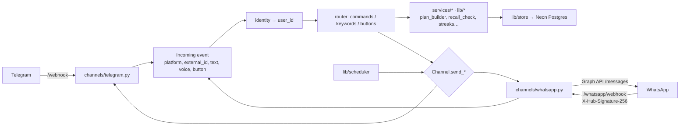

# Multi-Platform — Implementation Plan (WhatsApp first)

> Serve BismillahBot's reader, reciters, translations, daily ayat and hifz on
> messaging platforms beyond Telegram — **WhatsApp first** — from the same
> FastAPI service, the same Python business logic and the same database, so a
> feature is written once and every platform is a thin adapter.

**Status:** Phase 1 in progress on `feat/multi-platform`. §2 architecture
decisions confirmed 2026-11-01; §11 lists the business decisions still open
(they gate Phase 0/2, not Phase 1).
**Last updated:** 2026-11-01

Same conventions as `docs/HIFZ_PLATFORM.md` and `docs/MINI_APP_PLAN.md`: each
task has a checkbox, the files it touches, and a falsifiable **done-when**.
Decisions that change mid-build are amended in §2 and logged in §12, not
silently edited.

**Builds on `feat/mini-app`** (merged to `main` in PR #25, 2026-10-28). It
introduced `src/services/`, the Telegram-free service layer this plan builds on;
everything below refers to `main` from that merge on.

---

## 1. Scope

### In scope — feature parity map

| Feature | Telegram today | WhatsApp target | Notes |
|---|---|---|---|
| Verse lookup (`2:255`, surah names, ranges) | ✅ | Phase 2 | `parse_reference()` is platform-free already |
| Translations + tafsir (48 locales) | ✅ | Phase 2 | `t()` + `src/locales/*` reused as-is |
| Recitation audio (reciters, ayah/range) | ✅ | Phase 2 | everyayah mp3 sent **by link** — no re-upload |
| Mushaf page image | ✅ | Phase 2 | PNG by link |
| Settings (language, translation, reciter) | ✅ inline keyboards | Phase 2 | WhatsApp list messages (≤10 rows) |
| **Verse of the day** (scheduled push) | 🆕 not built | Phase 2, **both platforms** | New feature: Telegram's only daily push today is the hifz `plan_day` portion. **Paid template message on WhatsApp** — see §4 |
| Hifz: plans, drills, recall checks, streaks | ✅ | Phase 3 | Reply buttons (≤3) + numbered replies |
| Progress / streak image, leaderboard | ✅ | Phase 3 | Streak PNG works unchanged |
| Recitation checker (voice) | 🟨 planned | Phase 4 | WhatsApp voice notes are OGG/Opus, same as Telegram |
| Mini App | ✅ (Telegram WebApp) | Phase 5 | WhatsApp has no webview; open the app as a plain web page via a signed link |

### Stays Telegram-only (not ported)

- **Inline mode** (`@bot 2:255` in any chat) — no equivalent on WhatsApp.
- **Hifz groups** (`group_config`, group plans, weekly boards) — the WhatsApp
  Cloud API's group support is limited and changes often; revisit after Phase 3.
- The **menu button** / `web_app` buttons — Telegram-specific.

### Non-goals

- Unofficial WhatsApp libraries (whatsapp-web.js, Baileys, etc.). They break
  WhatsApp's terms, and the number gets banned — exactly the number your users know.
- A second codebase per platform. Business logic stays in `src/services/` and
  `src/lib/`; adapters only translate messages in and out.
- Cross-platform account linking in v1 (a user on both platforms has two
  separate profiles until Phase 6).

---

## 2. Decisions (architecture confirmed 2026-11-01; business rows still open)

| Area | Proposal | Why | Alternative considered |
|---|---|---|---|
| **WhatsApp API** | **Meta WhatsApp Cloud API, direct** (no BSP) | Official, no per-message reseller markup, webhook fits the existing FastAPI app | A BSP (Twilio, 360dialog…) — easier onboarding and a dashboard, but adds markup on every message |
| **Where it runs** | New `POST/GET /whatsapp/webhook` routes on the **existing** FastAPI service (Koyeb) | One deploy, one DB pool, one scheduler | Separate service — duplicates config and scheduler ownership |
| **Code shape** ✅ | `src/channels/` package: a `Channel` interface + one adapter per platform; a normalized `Incoming` event. **Converted incrementally:** `Ctx`/`SendCtx` carry `channel` alongside `bot`; Phase 1 converts only the surfaces Phase 2 ships (reader, audio, page, settings); hifz features convert in Phase 3 | ~94 `ctx.reply/edit` sites and ~63 keyboards: a big-bang conversion is one large, risky diff; incremental keeps the suite green at every step | Big-bang conversion of every handler in Phase 1 |
| **Identity** ✅ | New `identity(platform, external_id) → user_id` table. Existing Telegram users keep `user_id = telegram_user_id`; other platforms get **positive ids from a sequence starting at 2^52** | Telegram user ids fit in 52 bits, so no collision; stays under JS's 2^53 safe-integer limit (Mini App JSON); negative ids would clash with the existing `chat_id < 0` ⇒ group rule (`bot/dispatch.py`, `features/group.py`, `store/groups.py`) | Negative ids (original proposal) + an explicit chat-type field replacing every `< 0` check |
| **Buttons** ✅ | Neutral `Choice(label, data)` rows where `data` is today's `callback_data`. Telegram → InlineKeyboard; WhatsApp → reply buttons (≤3) / list (≤10) / numbered text, routed through the existing `router.dispatch_callback` | Callback strings (≤64 B on Telegram) fit WhatsApp's 256-char ids, so the router is reused unchanged | Separate hand-written WhatsApp menus and routing |
| **Daily ayat on WhatsApp** | **Opt-in only**, as an approved template; free when the user has written in the last 24 h | Meta requires documented opt-in and charges per template delivered (§4) | Push to everyone — breaks policy and costs scale with users |
| **Formatting** ✅ | **Telegram HTML stays the source format**; the WhatsApp channel converts `<b>`→`*…*`, `<i>`→`_…_`, `<a>`→text + url, strips other tags | Locales only use `<b>` and ~9 files add HTML; Telegram output stays byte-identical with no builder rewrite | Neutral span model rendered per channel (original P1.4) — rewrites every builder and snapshot |
| **Second platform** | Decide after WhatsApp ships, with real usage data (§10) | Avoid building for platforms nobody uses | — |

---

## 3. Architecture



`Channel` (sketch):

```python
class Channel(Protocol):
    platform: str                                   # "telegram" | "whatsapp"
    caps: Caps                                      # max_buttons, list_rows, inline_mode, web_app…
    async def send_text(self, to: str, msg: Message) -> None: ...
    async def send_audio(self, to: str, url: str, caption: str | None = None) -> None: ...
    async def send_image(self, to: str, url: str, caption: str | None = None) -> None: ...
    async def send_choices(self, to: str, msg: Message, choices: list[Choice]) -> None: ...
    async def send_template(self, to: str, name: str, lang: str, params: list[str]) -> None: ...
```

`send_choices` degrades by capability: Telegram renders an inline keyboard,
WhatsApp shows reply buttons (≤3), then a list message (≤10), then numbered text.

---

## 4. WhatsApp constraints that shape the design

Check these against Meta's official docs and rate card before Phase 2; the
figures below are from 2026 secondary sources (see References).

1. **24-hour service window.** After a user messages the bot, replies are free
   for 24 h. Reports differ on whether a monthly cap (~1,000 free
   service messages per number) now applies — verify.
2. **Business-initiated = template.** Anything sent outside the window (the
   daily ayat, drill reminders) must be a **pre-approved template**. Each
   language is a separate template submission.
3. **Per-message pricing** (since July 2025), by category and recipient
   country. A daily ayat is almost certainly classified **marketing**: about
   $0.025 in the US, roughly $0.01 in India, over $0.12 in Germany.
4. **Opt-in.** Documented opt-in that names the bot and WhatsApp is required;
   honour `STOP` immediately.
5. **AI chatbot policy (2026).** Meta restricts *general-purpose* AI assistants;
   a Qur'an content and memorization bot is a business-specific service. Keep
   it that way (no open-ended LLM chat on WhatsApp).
6. **Interactive limits:** 3 reply buttons, 10 list rows, 4,096-char text body.
   Long tafsir must be split, as Telegram's does today.

### Cost model for the daily ayat

`monthly cost ≈ opted-in subscribers × 30 × (share outside the 24-h window) × template rate`

| Subscribers | All outside window, $0.025 | Half reply daily (in window) |
|---|---|---|
| 100 | ~$75 / mo | ~$38 / mo |
| 1,000 | ~$750 / mo | ~$375 / mo |
| 10,000 | ~$7,500 / mo | ~$3,750 / mo |

To cut cost: make the daily message invite a reply ("reply 1 for the tafsir"),
which reopens the free window, and send the template only to users who haven't
written in the last 24 h. Charge, sponsor, or cap the WhatsApp daily tier if it
grows.

---

## 5. Data model changes (`src/common/schema.sql`)

```sql
CREATE TABLE IF NOT EXISTS identity (
    platform      TEXT   NOT NULL,              -- 'telegram' | 'whatsapp' | …
    external_id   TEXT   NOT NULL,              -- telegram id / E.164 wa_id
    user_id       BIGINT NOT NULL,
    created_at    TIMESTAMPTZ NOT NULL DEFAULT now(),
    last_inbound_at TIMESTAMPTZ,                -- drives the 24-h window check
    opted_in_at   TIMESTAMPTZ,                  -- WhatsApp daily-push consent
    opted_out_at  TIMESTAMPTZ,
    PRIMARY KEY (platform, external_id)
);
CREATE UNIQUE INDEX IF NOT EXISTS identity_user_platform_idx ON identity (user_id, platform);
-- 2^52: above every Telegram user id (≤52 bits), below JS's 2^53 safe limit.
CREATE SEQUENCE IF NOT EXISTS non_telegram_user_id START 4503599627370496;
```

- Telegram identity is **computed, not stored**, until Phase 6:
  `resolve('telegram', id)` returns `int(id)` with no I/O, so no update pays a
  DB write on Koyeb's 0.1 vCPU. Rows are written only for other platforms, and
  for Telegram once account linking needs them.
- `scheduled_send.target_chat_id` gets a sibling `platform TEXT NOT NULL DEFAULT 'telegram'`.
- Phase 2 adds `daily_ayah_sub(user_id PK, platform, send_time TIME, enabled,
  created_at)` for the verse of the day; the timezone comes from `profiles`.
- `tests/test_store_contract.py` extends to cover `identity`, so the memory
  store and asyncpg keep identical behaviour.

---

## 6. Phased task breakdown

### Phase 0 — Prerequisites (no code)

- [x] **P0.1 — Merge `feat/mini-app`.** ✅ 2026-10-28 — PR #25. `src/services/`
  is on `main`.
- [ ] **P0.2 — Meta onboarding.** Meta Business account → business
  verification → WhatsApp Business Account → a **dedicated** phone number not
  used in the WhatsApp app → display-name approval. *Done when:* a test message
  sent from the Cloud API dashboard arrives on a phone.
- [ ] **P0.3 — Templates.** Submit `daily_ayah` (params: reference, Arabic,
  translation) and `drill_reminder` in the launch languages (§11). *Done when:*
  both are **approved** for each launch language.
- [ ] **P0.4 — Budget decision** from §4's cost model. *Done when:* a monthly
  cap is agreed and recorded in §2.

### Phase 1 — Channel seam (this repo, no user-visible change)

- [x] **P1.0 — Plan detail and doc corrections.** ✅ 2026-11-01. Parity row for the verse of
  the day, Telegram identity computed rather than stored (§5), and this
  breakdown. *Done when:* committed.
- [x] **P1.1 — `src/channels/` package.** ✅ 2026-11-01.
  - `base.py`:
    - `Choice(label, data, url, web_app, switch_inline)`, with `Choices` as
      rows of `Choice`;
    - `Caps`;
    - `Incoming`;
    - the `Channel` protocol, **bound to one conversation**: `send_text`,
      `edit_text`, `send_image`, `send_audio`, `answer`, `typing`,
      `send_template`.
  - `telegram.py`: `TelegramChannel(bot, chat_id, thread_id)`. Its
    `to_markup(choices)` returns the same `InlineKeyboardMarkup` the code builds
    today. Media goes through `bot/media.send_cached`, so the file_id cache is
    unchanged.
  - `__init__.py`: the `for_platform(...)` factory.

  *Done when:* `tests/test_channels_telegram.py` covers every method against an
  `AsyncMock` bot.
- [ ] **P1.2 — Identity store + `scheduled_send.platform`.**
  - Schema per §5, as idempotent `IF NOT EXISTS` / `ADD COLUMN IF NOT EXISTS`.
  - `infra/store/identity.py` with memory and Postgres backends. Methods:
    `resolve`, `external_id`, `touch_inbound`, `last_inbound`, `opt_in`,
    `opt_out`, `consent`.
  - `ScheduledSend.platform`; `enqueue()` and `schedule_daily()` take
    `platform=`.

  *Done when:* the store contract tests cover allocation from 2^52, idempotent
  and concurrent resolve, Telegram pass-through, opt-in/out, and the `platform`
  round trip, on both backends.
- [ ] **P1.3 — Route Telegram through the seam.**
  - `Ctx` and `SendCtx` carry `channel` alongside `bot`; `bot` is removed in
    P3.5.
  - `ctx.reply`/`ctx.edit` take `choices=`. The existing `reply_markup` kwargs
    still pass through, so the 94 existing call sites keep working.
  - `bot/dispatch.handle_update` normalizes to `Incoming`. The shared
    `handle_incoming(channel, data, incoming)` keeps the routing order that
    `tests/test_dispatch_order.py` guards.
  - Converted to `Choices` + channel:
    - keyboards in `bot/keyboards/{verse,page,reciter,language,sajda}.py`;
    - handlers in `bot/handlers/*`;
    - `_search_reciters`;
    - `bot/media.py`. `send_quran(bot, …)` stays as a wrapper for hifz callers.
  - **Characterization first:** `tests/test_keyboard_snapshots.py` records
    every converted keyboard before the change.

  *Done when:*
  - the full suite (1924 passing at the start) passes. Assertion updates are
    allowed only for the mechanical `reply_markup`→`choices` change, each
    listed in the commit message.
  - `grep -E "ctx\.bot|ctx\.message\.|ctx\.callback_query\." src/bot/handlers`
    is empty.
  - a manual Telegram smoke test passes: lookup, each verse view, audio,
    page + page audio, reciter search, language change, a hifz drill.
- [ ] **P1.4 — HTML → WhatsApp markup converter**
  (`channels/whatsapp_format.py`).
  - `to_whatsapp(html)` converts `<b>`, `<i>`, `<s>`, `<code>`/`<pre>`,
    `<a href>`, unescapes entities and strips unknown tags.
  - `split(text, 4096)` splits on paragraph, then line, then word boundaries.

  *Done when:* tests cover every tag in `src/locales/*` and the builders, plus
  RTL text and the split boundaries.

### Phase 2 — WhatsApp MVP (reader + verse of the day)

Real-phone steps are gated by P0.2–P0.4; all code and tests can land before.

- [ ] **P2.0 — Config.** `whatsapp_enabled` plus the phone-number id, access
  token, app secret and verify token, in `config/settings.py`. `.env.example`
  gets placeholders. Everything is off unless enabled. *Done when:* the app
  boots unchanged with nothing configured.
- [ ] **P2.1 — Webhook** (`app/routes/whatsapp.py`, mounted only when enabled).
  - `GET` answers the verify-token handshake.
  - `POST` checks `X-Hub-Signature-256` (HMAC-SHA256 of the raw body,
    `hmac.compare_digest`), returns 200 at once, then processes via
    `app.tasks.spawn`.
  - Dedupe on the message id: Redis `SET NX EX 86400`, with an in-memory
    fallback.
  - Each inbound message calls `identity.touch_inbound`.

  *Done when:* recorded-payload tests (`tests/fixtures/whatsapp/`) prove that a
  forged signature gets 401, a duplicate is processed once, and status
  callbacks are ignored.
- [ ] **P2.2 — `channels/whatsapp.py`** over the Graph API `/messages` (httpx).
  - Text goes through P1.4.
  - `Choices` degrade by size:
    - ≤3 short callback choices become reply buttons;
    - ≤10 become a list message;
    - anything bigger becomes numbered text, with the number→`data` map kept
      per user with a TTL (`infra/choice_memory.py`).
  - URL choices become links. `web_app` and `switch_inline` choices are
    dropped.
  - `can_edit=False`, so an edit becomes a new message.
  - Retries with backoff on 429/5xx. Error 131047 (outside the 24-hour window)
    becomes `WindowClosed`.

  *Done when:* each send type has a mocked-httpx test and is verified on a real
  phone.
- [ ] **P2.3 — Media by link.** `GET /media/page/{n}.png` and
  `GET /media/repeat.mp3` sit next to `/media/range.mp3` and reuse the existing
  stitchers. Telegram is unchanged. *Done when:* route tests pass and WhatsApp
  shows the page image and plays the audio.
- [ ] **P2.4 — Router for a chat without commands.**
  - Keywords map to existing router commands: `menu`, `help`, `language`,
    `reciter`, `daily`, `stop`, plus their localized labels.
  - Button, list and numbered replies route as `callback_data` through
    `router.dispatch_callback`.
  - Free text goes to `read_text`.
  - First contact shows the language picker.

  *Done when:* every Phase 2 feature in §1 is reachable without typing a
  command name.
- [ ] **P2.5 — Verse of the day, both platforms** (`bot/features/daily.py`).
  - Subscriptions are stored in `daily_ayah_sub` (§5).
  - Everyone gets the same ayah each day: a hash of the date indexes a curated
    list.
  - `/daily` (Telegram) or `daily` (WhatsApp) turns it on or off and sets the
    time.
  - On WhatsApp, an explicit consent message names the bot, WhatsApp and `STOP`;
    confirming sets `opted_in_at`. `STOP` anywhere sets `opted_out_at`.
  - The `@send_handler("daily_ayah")` handler delivers and re-enqueues.

  *Done when:* contract and handler tests pass on both platforms.
- [ ] **P2.6 — Window-aware delivery** (`infra/scheduler/push.py:
  deliver_push`).
  - WhatsApp inside the 24-hour window: a free session message.
  - WhatsApp outside it: the approved template.
  - WhatsApp without consent: dropped and logged.
  - Telegram: always the session message.
  - Each push logs `platform`, `kind`, `category` and `template`.

  *Done when:* tests cover every branch, prove that no template is ever queued
  without consent, and the daily cost estimate can be read from the logs.
- [ ] **P2.7 — Launch to testers** (10–20 users). *Done when:* a week of daily
  sends with zero policy warnings in WhatsApp Manager.

### Phase 3 — Hifz on WhatsApp

- [ ] **P3.1 — Convert the hifz features** to `Choices` + channel, with
  snapshots first, as in P1.3:
  - `features/_plan_*`, `memorize.py`;
  - `check.py`, `progress.py`, `streak.py`, `leaderboard.py`, `profile.py`.
- [ ] **P3.2 — Plan wizard** over list messages + numbered replies;
  `router.dispatch_wizard` unchanged.
- [ ] **P3.3 — Recall checks** with 3 reply buttons (✅ knew it / 🟨 partly /
  ❌ forgot), mapped to the `services/check` outcomes.
- [ ] **P3.4 — `push_plan_day` through `deliver_push`** with the
  `drill_reminder` template.
- [ ] **P3.5 — Remove `Ctx.bot` / `SendCtx.bot`.** Group code keeps a
  `TelegramChannel`.

*Done when (phase):* one hifz scenario suite, parametrized over fake Telegram and
WhatsApp channels, asserts the same state transitions for a week of drills.

### Phase 4 — Recitation checker on WhatsApp

- [ ] **P4.1 — Voice notes.** `WhatsAppChannel.download_media(media_id)`
  feeds OGG/Opus into the same pipeline as Telegram voice. Blocked on the
  recitation checker landing on `main`.

### Phase 5 — Web access outside Telegram

- [ ] **P5.1 — Signed magic link.** `POST /auth/link` in `src/api/auth.py`.
  - It accepts an HMAC-signed `{user_id, exp ≤ 10 min, nonce}` token and
    returns the same JWT as the `initData` flow.
  - The nonce is single-use (Redis).
  - The bot's `app` keyword on WhatsApp sends the link.

  *Done when:* expired, reused and tampered tokens are each rejected.

### Phase 6 — Later

- [ ] **Account linking.** A one-time code from one platform, entered on the
  other, re-points the `identity` row to the existing `user_id`. The target
  account's hifz data wins. Telegram identity rows start being stored here.
- [ ] **Second platform**, chosen from §10 by real demand.
- [ ] **Hifz groups on WhatsApp**, if the Groups API matures.

---

## 7. Testing

- Every adapter tested against recorded webhook payloads (fixtures in
  `tests/fixtures/whatsapp/`), never live calls in CI.
- Signature verification, opt-in gating and window-vs-template selection get
  explicit tests: they are the policy and money risks.
- Existing Telegram suite must pass unchanged through Phase 1 — that is the
  proof the seam changed nothing.

---

## 8. Configuration (names only; values live in the deployment)

New settings, added to `.env.example` with placeholders and read in `src/config/env.py`:
WhatsApp phone-number id, access token, app secret (webhook signature), verify
token (handshake), and a `WHATSAPP_ENABLED` flag. Like `MINIAPP_URL`, everything
stays off until configured, so a deployment without WhatsApp behaves exactly as today.

---

## 9. Risks

| Risk | Impact | Mitigation |
|---|---|---|
| Template costs grow with subscribers | Monthly bill scales linearly | Opt-in only, reply-to-reopen-window design, cap in P0.4, cost logging (P2.5) |
| Number quality rating drops (users block/report) | Messaging limits cut, number restricted | Opt-in only, easy `STOP`, no unsolicited pushes |
| Meta template rejection or recategorisation (utility → marketing) | Daily ayat blocked or pricier | Submit early (P0.3), keep templates factual |
| Koyeb 0.1 vCPU capacity (`docs/KOYEB_CAPACITY_REPORT.md`) | Slow webhooks → Meta retries → duplicates | Ack-then-process, idempotency on WhatsApp message ids |
| Phase 1 refactor regresses Telegram | Existing users affected | No behaviour change allowed; full suite + smoke test gate |

---

## 10. Other platforms — shortlist for Phase 6

| Platform | Bot API | Business-initiated messages | Fit |
|---|---|---|---|
| **Facebook Messenger / Instagram DM** | Official (Meta, same app as WhatsApp) | Restricted after 24 h, similar to WhatsApp | Easy second adapter once Meta onboarding exists |
| **Viber** | Official bot API | Commercial terms for bots apply — check | Popular in parts of Eastern Europe and Central Asia |
| **Discord** | Official, free | Free | Communities / study circles; good fit for hifz groups |
| **Web / PWA** | — | Web push (free) | Phase 5 already makes the Mini App work in a browser |
| **Signal** | No official bot API | — | Not recommended |

Pick using: where your users actually are (bot analytics by language/country),
cost of daily pushes, and whether groups matter.

---

## 11. Open decisions (needed before Phase 0/2; Phase 1 does not depend on them)

1. **Launch countries / languages** for WhatsApp — sets template languages and
   the per-message rate.
2. **Daily ayat budget** on WhatsApp, or whether it is in-window only.
3. **Phone number** to dedicate to the WhatsApp bot (must not be in the WhatsApp app).
4. **Cloud API direct vs a BSP** (recommendation: direct).
5. **Second platform** priority, if you already know it.

---

## 12. Change log

- 2026-10-29 — Plan drafted.
- 2026-10-29 — P0.1 done: `feat/mini-app` was already merged (PR #25).
- 2026-11-01 — Architecture decisions confirmed. Changed from the draft: ids for
  new platforms are positive from 2^52 (negative ids clashed with the
  `chat_id < 0` group rule); Phase 1 converts incrementally instead of every
  handler; HTML stays the source format with a WhatsApp converter (P1.4
  rewritten); `Choice.data` reuses `callback_data`. Paths updated to the
  post-refactor layout (`bot/dispatch.py`, `bot/context.py`, `infra/store/`).
- 2026-11-01 — Phases 1–6 broken into tasks. Correction: Telegram has no
  standalone daily-ayat push (the backlog item shipped as the hifz `plan_day`);
  the verse of the day is a **new feature on both platforms** in Phase 2
  (P2.5). Telegram identity is computed, not stored, until Phase 6. Stitched
  pages and repeated audio get public routes so WhatsApp can send them by link
  (P2.3).
- 2026-11-01 — P1.1 done. `channels` sits in the **infra tier**
  (`tests/test_layering.py`): the scheduler in `infra` builds a channel per
  queued send, so `channels` may not import `bot`. The Telegram transport the
  bot layer owned — `send_cached` (file_id cache) and `ignore_not_modified` —
  moved to `channels/telegram.py`; `bot/media.py` and `bot/errors.py` re-export it.

## References

- `docs/MINI_APP_PLAN.md` — service-layer extraction this plan depends on.
- `docs/KOYEB_CAPACITY_REPORT.md` — CPU budget for the webhook.
- WhatsApp pricing and policy summaries (2026, secondary — verify against Meta):
  [EngageLab rate overview](https://www.engagelab.com/blog/whatsapp-api-pricing),
  [Blueticks per-message pricing](https://blueticks.co/blog/whatsapp-business-pricing-change-2026-per-message),
  [opt-in rules](https://wetarseel.ai/whatsapp-business-api-opt-in-rules/),
  [AI chatbot policy changes](https://waba.nxccontrols.in/blog/whatsapp-api-ai-chatbot-policy-update-2026-guide).
