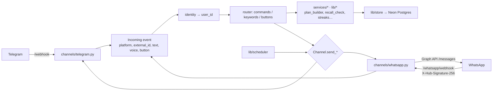

# Multi-Platform — Implementation Plan (WhatsApp first)

> Serve BismillahBot's reader, reciters, translations, daily ayat and hifz on
> messaging platforms beyond Telegram — **WhatsApp first** — from the same
> FastAPI service, the same Python business logic and the same database, so a
> feature is written once and every platform is a thin adapter.

**Status:** Proposal — nothing built. §2 decisions are recommendations awaiting
confirmation; §11 lists what needs an answer before Phase 1.
**Last updated:** 2026-10-29

Same conventions as `docs/HIFZ_PLATFORM.md` and `docs/MINI_APP_PLAN.md`: each
task has a checkbox, the files it touches, and a falsifiable **done-when**.
Decisions that change mid-build are amended in §2 and logged in §12, not
silently edited.

**Builds on `feat/mini-app`** (merged to `main` in PR #25, 2026-10-28). It
introduced `src/services/`, the Telegram-free service layer this plan builds on;
everything below refers to `main` from that merge on.

---

## 1. Scope

### In scope — feature parity map

| Feature | Telegram today | WhatsApp target | Notes |
|---|---|---|---|
| Verse lookup (`2:255`, surah names, ranges) | ✅ | Phase 2 | `parse_reference()` is platform-free already |
| Translations + tafsir (48 locales) | ✅ | Phase 2 | `t()` + `src/locales/*` reused as-is |
| Recitation audio (reciters, ayah/range) | ✅ | Phase 2 | everyayah mp3 sent **by link** — no re-upload |
| Mushaf page image | ✅ | Phase 2 | PNG by link |
| Settings (language, translation, reciter) | ✅ inline keyboards | Phase 2 | WhatsApp list messages (≤10 rows) |
| **Daily ayat** (scheduled push) | ✅ | Phase 2 | **Paid template message on WhatsApp** — see §4 |
| Hifz: plans, drills, recall checks, streaks | ✅ | Phase 3 | Reply buttons (≤3) + numbered replies |
| Progress / streak image, leaderboard | ✅ | Phase 3 | Streak PNG works unchanged |
| Recitation checker (voice) | 🟨 planned | Phase 4 | WhatsApp voice notes are OGG/Opus, same as Telegram |
| Mini App | ✅ (Telegram WebApp) | Phase 5 | WhatsApp has no webview; open the app as a plain web page via a signed link |

### Stays Telegram-only (not ported)

- **Inline mode** (`@bot 2:255` in any chat) — no equivalent on WhatsApp.
- **Hifz groups** (`group_config`, group plans, weekly boards) — the WhatsApp
  Cloud API's group support is limited and changes often; revisit after Phase 3.
- The **menu button** / `web_app` buttons — Telegram-specific.

### Non-goals

- Unofficial WhatsApp libraries (whatsapp-web.js, Baileys, etc.). They break
  WhatsApp's terms, and the number gets banned — exactly the number your users know.
- A second codebase per platform. Business logic stays in `src/services/` and
  `src/lib/`; adapters only translate messages in and out.
- Cross-platform account linking in v1 (a user on both platforms has two
  separate profiles until Phase 6).

---

## 2. Decisions (proposed — confirm before Phase 1)

| Area | Proposal | Why | Alternative considered |
|---|---|---|---|
| **WhatsApp API** | **Meta WhatsApp Cloud API, direct** (no BSP) | Official, no per-message reseller markup, webhook fits the existing FastAPI app | A BSP (Twilio, 360dialog…) — easier onboarding and a dashboard, but adds markup on every message |
| **Where it runs** | New `POST/GET /whatsapp/webhook` routes on the **existing** FastAPI service (Koyeb) | One deploy, one DB pool, one scheduler | Separate service — duplicates config and scheduler ownership |
| **Code shape** | `src/channels/` package: a `Channel` interface + one adapter per platform; a normalized `Incoming` event; handlers move from `bot.send_*` to `channel.send_*` | The scheduler already dispatches by registered send kind (`@send_handler`), so a channel is the natural seam | Branching on platform inside each handler — spreads platform code everywhere |
| **Identity** | New `identity(platform, external_id) → user_id` table. Existing Telegram users keep `user_id = telegram_user_id`; other platforms get **negative** ids from a sequence | No rewrite of existing rows; ids can never collide (Telegram ids are positive); `user_id` columns keep working everywhere | Rename every `telegram_user_id` column now — a big migration that buys nothing yet |
| **Daily ayat on WhatsApp** | **Opt-in only**, as an approved template; free when the user has written in the last 24 h | Meta requires documented opt-in and charges per template delivered (§4) | Push to everyone — breaks policy and costs scale with users |
| **Formatting** | Render from one neutral message model: Telegram → HTML, WhatsApp → `*bold*`/`_italic_` | Keeps locales and message builders single-source | Separate locale strings per platform → drift |
| **Second platform** | Decide after WhatsApp ships, with real usage data (§10) | Avoid building for platforms nobody uses | — |

---

## 3. Architecture



`Channel` (sketch):

```python
class Channel(Protocol):
    platform: str                                   # "telegram" | "whatsapp"
    caps: Caps                                      # max_buttons, list_rows, inline_mode, web_app…
    async def send_text(self, to: str, msg: Message) -> None: ...
    async def send_audio(self, to: str, url: str, caption: str | None = None) -> None: ...
    async def send_image(self, to: str, url: str, caption: str | None = None) -> None: ...
    async def send_choices(self, to: str, msg: Message, choices: list[Choice]) -> None: ...
    async def send_template(self, to: str, name: str, lang: str, params: list[str]) -> None: ...
```

`send_choices` degrades by capability: Telegram renders an inline keyboard,
WhatsApp shows reply buttons (≤3), then a list message (≤10), then numbered text.

---

## 4. WhatsApp constraints that shape the design

Check these against Meta's official docs and rate card before Phase 2; the
figures below are from 2026 secondary sources (see References).

1. **24-hour service window.** After a user messages the bot, replies are free
   for 24 h. Reports differ on whether a monthly cap (~1,000 free
   service messages per number) now applies — verify.
2. **Business-initiated = template.** Anything sent outside the window (the
   daily ayat, drill reminders) must be a **pre-approved template**. Each
   language is a separate template submission.
3. **Per-message pricing** (since July 2025), by category and recipient
   country. A daily ayat is almost certainly classified **marketing**: about
   $0.025 in the US, roughly $0.01 in India, over $0.12 in Germany.
4. **Opt-in.** Documented opt-in that names the bot and WhatsApp is required;
   honour `STOP` immediately.
5. **AI chatbot policy (2026).** Meta restricts *general-purpose* AI assistants;
   a Qur'an content and memorization bot is a business-specific service. Keep
   it that way (no open-ended LLM chat on WhatsApp).
6. **Interactive limits:** 3 reply buttons, 10 list rows, 4,096-char text body.
   Long tafsir must be split, as Telegram's does today.

### Cost model for the daily ayat

`monthly cost ≈ opted-in subscribers × 30 × (share outside the 24-h window) × template rate`

| Subscribers | All outside window, $0.025 | Half reply daily (in window) |
|---|---|---|
| 100 | ~$75 / mo | ~$38 / mo |
| 1,000 | ~$750 / mo | ~$375 / mo |
| 10,000 | ~$7,500 / mo | ~$3,750 / mo |

To cut cost: make the daily message invite a reply ("reply 1 for the tafsir"),
which reopens the free window, and send the template only to users who haven't
written in the last 24 h. Charge, sponsor, or cap the WhatsApp daily tier if it
grows.

---

## 5. Data model changes (`src/common/schema.sql`)

```sql
CREATE TABLE IF NOT EXISTS identity (
    platform      TEXT   NOT NULL,              -- 'telegram' | 'whatsapp' | …
    external_id   TEXT   NOT NULL,              -- telegram id / E.164 wa_id
    user_id       BIGINT NOT NULL,
    created_at    TIMESTAMPTZ NOT NULL DEFAULT now(),
    last_inbound_at TIMESTAMPTZ,                -- drives the 24-h window check
    opted_in_at   TIMESTAMPTZ,                  -- WhatsApp daily-push consent
    opted_out_at  TIMESTAMPTZ,
    PRIMARY KEY (platform, external_id)
);
CREATE UNIQUE INDEX IF NOT EXISTS identity_user_platform_idx ON identity (user_id, platform);
CREATE SEQUENCE IF NOT EXISTS non_telegram_user_id START -1 INCREMENT -1;
```

- Telegram rows are backfilled lazily: on the first update from a user,
  insert `('telegram', <id>, <id>)`. No bulk migration.
- `scheduled_send.target_chat_id` gets a sibling `platform TEXT NOT NULL DEFAULT 'telegram'`.
- `tests/test_store_contract.py` extends to cover `identity`, so the memory
  store and asyncpg keep identical behaviour.

---

## 6. Phased task breakdown

### Phase 0 — Prerequisites (no code)

- [x] **P0.1 — Merge `feat/mini-app`.** ✅ 2026-10-28 — PR #25. `src/services/`
  is on `main`.
- [ ] **P0.2 — Meta onboarding.** Meta Business account → business
  verification → WhatsApp Business Account → a **dedicated** phone number not
  used in the WhatsApp app → display-name approval. *Done when:* a test message
  sent from the Cloud API dashboard arrives on a phone.
- [ ] **P0.3 — Templates.** Submit `daily_ayat` (params: reference, Arabic,
  translation) and `drill_reminder` in the launch languages (§11). *Done when:*
  both are **approved** for each launch language.
- [ ] **P0.4 — Budget decision** from §4's cost model. *Done when:* a monthly
  cap is agreed and recorded in §2.

### Phase 1 — Channel seam (this repo, no user-visible change)

- [ ] **P1.1 — `src/channels/` package:** `base.py` (`Channel`, `Caps`,
  `Message`, `Choice`, `Incoming`), `telegram.py` wrapping python-telegram-bot.
  *Done when:* unit tests cover each `send_*` against an `AsyncMock` bot.
- [ ] **P1.2 — Identity table + store methods** (§5) in `lib/store/` for both
  backends. *Done when:* the store contract tests pass for memory and Postgres.
- [ ] **P1.3 — Route Telegram through the seam.** `main.handle_update`
  normalizes to `Incoming`; `hifz.Ctx` carries `channel` instead of `bot`;
  scheduler `SendCtx` sends via `Channel`. *Done when:* the full existing suite
  passes unchanged and a manual Telegram smoke test (lookup, audio, daily post,
  drill) behaves identically.
- [ ] **P1.4 — Neutral message rendering.** Message builders emit `Message`
  (text + spans); per-channel renderers produce HTML / WhatsApp markup.
  *Done when:* snapshot tests show identical Telegram output to today.

### Phase 2 — WhatsApp MVP (reader + daily ayat)

- [ ] **P2.1 — Webhook.** `GET /whatsapp/webhook` (verify token handshake),
  `POST` with `X-Hub-Signature-256` HMAC verification against the app secret,
  then 200 immediately and process async (Meta retries slow webhooks).
  *Done when:* a forged signature is rejected (test) and a real message reaches
  the router.
- [ ] **P2.2 — `channels/whatsapp.py`** over the Graph API `/messages`: text,
  audio/image by link, reply buttons, list messages, templates; retry with
  backoff on 429/5xx. *Done when:* each send type is verified on a real phone.
- [ ] **P2.3 — Router for a keyboard-less chat.** Free text references
  (`2:255`, `Al-Baqara 255`), `menu`, `language`, `reciter`, `help`; numbered
  replies map to `Choice`s. *Done when:* every Phase 2 feature in §1 is reachable
  without typing a command name.
- [ ] **P2.4 — Opt-in / opt-out flow.** `daily` → explicit consent message →
  `opted_in_at`; `STOP` anywhere → `opted_out_at`, no further templates.
  *Done when:* tests prove no template is ever queued for a user without
  `opted_in_at` or with `opted_out_at`.
- [ ] **P2.5 — Window-aware scheduler.** For WhatsApp targets: inside the 24-h
  window send a free session message, otherwise the approved template; log the
  category for cost tracking. *Done when:* tests cover both branches and the
  daily cost estimate can be read from logs.
- [ ] **P2.6 — Launch to testers** (10–20 users). *Done when:* a week of daily
  ayat delivered with zero policy warnings in WhatsApp Manager.

### Phase 3 — Hifz on WhatsApp

- [ ] **P3.1 — Plan wizard** (`lib/wizard.py`) via list messages + numbered replies.
- [ ] **P3.2 — Drills and recall checks** with 3-button answers
  (✅ knew it / 🟨 partly / ❌ forgot), mapped to the existing `recall_check` outcomes.
- [ ] **P3.3 — Progress, streak image, leaderboard** reusing `services/progress`.
  *Done when (phase):* a plan created on WhatsApp runs a full week of drills with
  the same state transitions the Telegram tests assert.

### Phase 4 — Recitation checker on WhatsApp

- [ ] **P4.1 — Voice notes:** download the media by id (Graph API), feed the
  same pipeline as Telegram voice. Depends on the recitation checker plan.

### Phase 5 — Web access outside Telegram

- [ ] **P5.1 — Signed magic link:** the bot sends a short-lived signed URL;
  the Mini App accepts it as an alternative to `initData` and gets the same JWT
  (`src/api/auth.py`). This makes the Mini App usable from WhatsApp and browsers.

### Phase 6 — Later

- [ ] **Second platform** chosen from §10 by real demand.
- [ ] **Account linking** across platforms: a one-time code from one platform
  entered on the other merges identities into one `user_id`.
- [ ] **Hifz groups on WhatsApp**, if the Groups API matures.

---

## 7. Testing

- Every adapter tested against recorded webhook payloads (fixtures in
  `tests/fixtures/whatsapp/`), never live calls in CI.
- Signature verification, opt-in gating and window-vs-template selection get
  explicit tests: they are the policy and money risks.
- Existing Telegram suite must pass unchanged through Phase 1 — that is the
  proof the seam changed nothing.

---

## 8. Configuration (names only; values live in the deployment)

New settings, added to `.env.example` with placeholders and read in `src/config/env.py`:
WhatsApp phone-number id, access token, app secret (webhook signature), verify
token (handshake), and a `WHATSAPP_ENABLED` flag. Like `MINIAPP_URL`, everything
stays off until configured, so a deployment without WhatsApp behaves exactly as today.

---

## 9. Risks

| Risk | Impact | Mitigation |
|---|---|---|
| Template costs grow with subscribers | Monthly bill scales linearly | Opt-in only, reply-to-reopen-window design, cap in P0.4, cost logging (P2.5) |
| Number quality rating drops (users block/report) | Messaging limits cut, number restricted | Opt-in only, easy `STOP`, no unsolicited pushes |
| Meta template rejection or recategorisation (utility → marketing) | Daily ayat blocked or pricier | Submit early (P0.3), keep templates factual |
| Koyeb 0.1 vCPU capacity (`docs/KOYEB_CAPACITY_REPORT.md`) | Slow webhooks → Meta retries → duplicates | Ack-then-process, idempotency on WhatsApp message ids |
| Phase 1 refactor regresses Telegram | Existing users affected | No behaviour change allowed; full suite + smoke test gate |

---

## 10. Other platforms — shortlist for Phase 6

| Platform | Bot API | Business-initiated messages | Fit |
|---|---|---|---|
| **Facebook Messenger / Instagram DM** | Official (Meta, same app as WhatsApp) | Restricted after 24 h, similar to WhatsApp | Easy second adapter once Meta onboarding exists |
| **Viber** | Official bot API | Commercial terms for bots apply — check | Popular in parts of Eastern Europe and Central Asia |
| **Discord** | Official, free | Free | Communities / study circles; good fit for hifz groups |
| **Web / PWA** | — | Web push (free) | Phase 5 already makes the Mini App work in a browser |
| **Signal** | No official bot API | — | Not recommended |

Pick using: where your users actually are (bot analytics by language/country),
cost of daily pushes, and whether groups matter.

---

## 11. Open decisions (needed before Phase 1)

1. **Launch countries / languages** for WhatsApp — sets template languages and
   the per-message rate.
2. **Daily ayat budget** on WhatsApp, or whether it is in-window only.
3. **Phone number** to dedicate to the WhatsApp bot (must not be in the WhatsApp app).
4. **Cloud API direct vs a BSP** (recommendation: direct).
5. **Second platform** priority, if you already know it.

---

## 12. Change log

- 2026-10-29 — Plan drafted.
- 2026-10-29 — P0.1 done: `feat/mini-app` was already merged (PR #25).

## References

- `docs/MINI_APP_PLAN.md` — service-layer extraction this plan depends on.
- `docs/KOYEB_CAPACITY_REPORT.md` — CPU budget for the webhook.
- WhatsApp pricing and policy summaries (2026, secondary — verify against Meta):
  [EngageLab rate overview](https://www.engagelab.com/blog/whatsapp-api-pricing),
  [Blueticks per-message pricing](https://blueticks.co/blog/whatsapp-business-pricing-change-2026-per-message),
  [opt-in rules](https://wetarseel.ai/whatsapp-business-api-opt-in-rules/),
  [AI chatbot policy changes](https://waba.nxccontrols.in/blog/whatsapp-api-ai-chatbot-policy-update-2026-guide).
