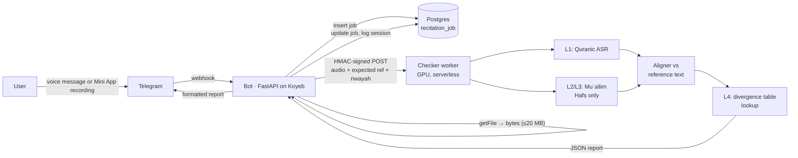

# Recitation Checker — Investigation and Plan

> Can BismillahBot listen to a user reciting, decide whether the recitation is
> correct **for the qirāʾah / riwāyah they chose**, and send back a clear report
> of where it went wrong — wrong word, skipped word, wrong ḥarakah, a tajwīd
> rule, or a word read in a *different* riwāyah than the one selected?

**Status:** scope decided (2026-10-27) — **Hafṣ + Warsh, word-level (L1)**,
hosted on paid Koyeb. Nothing built yet. §9 records the decisions, §10 the
roadmap, §11 the infrastructure, capacity and cost on Koyeb.
**Last updated:** 2026-10-27

---

## 0. Bottom line up front

- **Hafṣ ʿan ʿĀṣim is feasible now**, at two depths: *word-level* (wrong /
  missing / extra word, the level Tarteel ships) and *phoneme + tajwīd-level*
  (ḥarakāt, madd length, ghunnah, qalqalah, tafkhīm…) via the open
  **Quran Muʿallim** model. Both run on a GPU worker, not on the current
  512 MB Koyeb instance.
- **Warsh ʿan Nāfiʿ is feasible at word level** (open ASR models already cover
  Hafṣ + Warsh); phoneme/tajwīd depth for Warsh does not exist in open source
  and would be our own training work.
- **The other riwāyāt (Qālūn, al-Dūrī, al-Sūsī, Shuʿbah, al-Bazzī, Qunbul, …)
  have no usable open model.** Riwāyah *identification* research exists (≈82 %
  Hafṣ-vs-Warsh accuracy) — not good enough to tell a user they are wrong.
- **The tractable way to "detect the wrong qirāʾah"** is not a general
  qirāʾah classifier. It is a **closed-set check at known divergence points**:
  we know, word by word, where riwāyāt differ (*farsh al-ḥurūf*). When the user's
  recitation at such a word matches another riwāyah's form instead of the
  selected one, we can say so precisely: *"67:14 — you read X as in Hafṣ; in
  Warsh it is Y."* That needs a word-level ASR plus a divergence table, not a
  new research model.
- **Recommended path:** Phase A Hafṣ word-level → Phase B Hafṣ tajwīd via
  Muʿallim → Phase C Warsh + qirāʾah-mixing detection at divergence points →
  further riwāyāt only with data and a qualified reviewer.

---

### 0.1 Decision (2026-10-27)

- **Riwāyāt:** Hafṣ ʿan ʿĀṣim and Warsh ʿan Nāfiʿ. The UI offers only these
  two. The other 18 riwāyāt stay out of scope: no open model exists for them.
- **Depth:** word level (L1) — wrong, skipped, extra and out-of-order words,
  and a jump to another ayah. Tajwīd (L2/L3, Hafṣ only) is an optional later
  phase that needs a GPU (§10 Phase B, §11.4).
- **No qualified reviewer (qāriʾ with ijāzah) is available.** Consequences:
  evaluation uses known-correct professional recitations plus synthetic
  errors (§7); riwāyah-mismatch detection (L4) is **not** shipped, because its
  divergence table cannot be verified; tajwīd verdicts stay off.
- **Hosting:** paid Koyeb. Word level runs on a **CPU** worker — no GPU is
  needed for the decided scope (§11).

## 1. Terminology (so the report language is right)

| Term | Meaning | Example |
|---|---|---|
| **Qirāʾah** (pl. qirāʾāt) | One of the 10 canonical readings, named after its imām | Qirāʾah of ʿĀṣim, of Nāfiʿ |
| **Riwāyah** (pl. riwāyāt) | A transmission of a qirāʾah — 2 per imām, 20 total | Hafṣ ʿan ʿĀṣim, Warsh ʿan Nāfiʿ |
| **Ṭarīq** (pl. ṭuruq) | A sub-chain within a riwāyah; changes details like madd length | Hafṣ via al-Shāṭibiyyah |
| **Uṣūl** | Systematic rules of a riwāyah (madd lengths, imālah, naql, ṣilah of mīm al-jamʿ…) | Warsh: 6-count madd badal options, naql |
| **Farsh al-ḥurūf** | Word-specific differences, listed per occurrence | مَلِكِ vs مَـٰلِكِ (1:4) |
| **Talfīq** | Mixing riwāyāt within one recitation — what "wrong qirāʾah" usually means in practice | Reading Warsh but a Hafṣ form slips in |

What users call "checking by qirāʾah" is really **checking against a selected
riwāyah (and ideally ṭarīq)**. The UI and reports should say *riwāyah*, with the
qirāʾah shown as context.

The bot today shows **Hafṣ text only** (images, `translations/ar.txt`), and its
reciter catalogue already flags 3 Warsh recordings as `kind: riwayah`
(`src/common/performers.json`, BUSINESS_LOGIC.md §4). So the product already
acknowledges the distinction — the checker would be the first feature that
*acts* on it.

---

## 2. What "correct" can mean — error taxonomy

| Level | Error class | Detectable today? | How |
|---|---|---|---|
| **L1 Word** | Wrong word, skipped word, extra word, wrong order, repeated ayah, jumped ayah | ✅ Hafṣ, ✅ Warsh | ASR → align to reference text |
| **L2 Ḥarakah / letter** | Fatḥah↔ḍammah↔kasrah, sukūn missed, letter substituted (س/ص, ت/ط, ه/ح, ذ/ز) | ✅ Hafṣ (Muʿallim) | Phoneme CTC → align to phonetic reference |
| **L3 Tajwīd** | Madd length, ghunnah, ikhfāʾ/idghām/iqlāb, qalqalah, tafkhīm/tarqīq, ṣifāt | ✅ Hafṣ (Muʿallim), ❌ others | Multi-level CTC (phoneme + ṣifāt heads) |
| **L4 Riwāyah mismatch** | A divergence-point word read in another riwāyah's form | 🟨 buildable for Hafṣ↔Warsh | L1/L2 output compared against a per-riwāyah divergence table |
| **L5 Waqf / ibtidāʾ** | Stopping or starting at a place that changes meaning | ❌ | Research problem; out of scope |

**Promise only what we can measure.** Tarteel, the commercial leader, still
publicly limits itself to word-level mistakes (missed, wrong, extra words) and
says letter-level and tajwīd detection are not supported yet. Shipping L1 well
beats shipping L3 badly.

---

## 3. Landscape (verified 2026-10)

### 3.1 Commercial

| Option | Depth | Riwāyāt | API for us? | Notes |
|---|---|---|---|---|
| **Tarteel AI** | L1 (word), real-time, <200 ms | Hafṣ | **No public developer API** | Proves the UX. 75k+ minutes of curated training data. Partnership would be a business conversation, not an integration. |

No commercial provider offers a riwāyah-aware recitation API we could call.
We would self-host.

### 3.2 Open models and data

| Resource | What it is | Riwāyāt | Use for us |
|---|---|---|---|
| **Quran Muʿallim** — `obadx/muaalem-model-v3_2`, PyPI `quran-muaalem`, `quran-transcript` | Wav2Vec2-BERT, multi-level CTC: phonemes + 10 ṣifāt heads, compared to a phonetic reference script. ~660M params, ~1.5 GB VRAM, 16 kHz input | **Hafṣ only**; configurable *moshaf attributes* (madd lengths per ṭarīq, recitation speed mujawwad→ḥadr, 40+ rules) | **L2 + L3 for Hafṣ.** Best available. **Licence: "Quran Muaalem License" = Apache 2.0 + conditions** — must show an AI disclaimer before first use, **no advertisements**, free access for low-income users. Compatible with this bot as it is today; needs legal sign-off. |
| **Abdou/quran-asr-tiny** | 16M-param Quranic ASR; professional and phone-quality audio; tartīl → ḥadr | **Hafṣ + Warsh** | **L1 for both**, cheap enough for CPU inference. Accuracy on our users' audio must be measured (§7). |
| Other HF Quranic ASR models (`Nuwaisir/Quran_speech_recognizer`, Whisper fine-tunes) | Word/char ASR | Mostly Hafṣ | Fallbacks / ensemble candidates |
| **IqraEval 2025** shared task (ArabicNLP 2025) | First open benchmark + leaderboard for Qur'anic mispronunciation detection | Hafṣ | Benchmark and baselines (Whisper-large-v3 speech-to-phoneme, wav2vec2-CTC). Best F1 numbers are modest (~0.3 F1 at phoneme level for some systems) — evidence that L2/L3 has meaningful false-positive rates. |
| **Riwaya-ID** (OpenReview) | Riwāyah identification over 6 riwāyāt | Hafṣ, Warsh, Qālūn, al-Bazzī, Qunbul, Ibn Jammāz | **Not usable for verdicts** — ~82 % Hafṣ-vs-Warsh. Useful only as a soft "this sounds like Warsh, did you mean to select Warsh?" hint. |
| **quranlab/quran-audio** | 245 reciters, reciter→riwāyāt taxonomy, per-surah reference audio across 15 qirāʾāt/riwāyāt | 15 | Reference audio + training data for Phase C/D |
| **Quran-Lab/quranic-asr-benchmark** | 600 leakage-free clips | Hafṣ | Held-out evaluation set |
| **everyayah.com** (already our CDN) | Per-ayah mp3s; includes 3 Warsh reciters | Hafṣ + Warsh | Reference playback in reports ("hear it correctly") — already wired in the bot |

### 3.3 Reference *text* per riwāyah

Checking needs the exact text of the selected riwāyah, not just audio.

- **Hafṣ:** already bundled (`translations/ar.txt`, Tanzil). Muʿallim ships its
  own phonetic reference via `quran-transcript`.
- **Warsh, Qālūn, al-Dūrī, al-Sūsī, Shuʿbah, al-Bazzī, Qunbul:** the King Fahd
  Glorious Qur'an Printing Complex (KFGQPC) publishes digital muṣḥaf text/fonts
  for several riwāyāt. **Licence and exact file formats must be confirmed
  before use** — do not assume Tanzil-style permissive terms.
- **Divergence table (L4):** derived by diffing the per-riwāyah texts
  word-by-word after normalising orthography (rasm differences that are not
  pronunciation differences must be excluded). Output: for each `(surah, ayah,
  word_index)`, the form in each supported riwāyah. This table **must be
  reviewed by someone with ijāzah in those riwāyāt** — it is the part users
  will trust most.

---

## 4. Proposed architecture

The Koyeb instance (0.1 vCPU, 512 MB — `docs/KOYEB_CAPACITY_REPORT.md`) cannot
host a 660M-param model, nor even comfortably decode audio under load. The
checker is a **separate inference service**; the bot only orchestrates.



### 4.1 Flow

1. User picks what they will recite: `/recite 67:1-5` (or "recite today's
   portion" on a drill card, or from `/check`). The riwāyah comes from a new
   `user_profile.riwayah` setting (default Hafṣ).
2. Bot replies *"Send a voice message reciting 67:1–5 (Hafṣ)."* — a wizard step
   using the existing `@wizard` seam (`src/hifz/__init__.py`), so it fits the
   current router with one new feature module (`src/hifz/recite.py`).
3. User sends a **voice note** (OGG/Opus, 48 kHz). Bot validates duration
   (cap: ~3 min / one mushaf page in v1), creates a `recitation_job` row,
   answers *"Listening… ⏳"*.
4. Bot downloads the file via `getFile` (Bot API download limit 20 MB — far
   above a 3-min voice note) and POSTs bytes + `{expected_ref, riwayah,
   moshaf_attributes, job_id}` to the worker, signed with a shared HMAC secret.
   The file URL is never handed to the worker because it embeds the bot token.
5. Worker: decode + resample to 16 kHz mono (ffmpeg) → VAD trim → run L1 (and
   L2/L3 for Hafṣ) → align → L4 lookup → return the report JSON (§5.1).
6. Bot stores the result, edits the "Listening…" message into the report (§5),
   and — if it passes — logs a session (new `session_log.kind =
   'recitation'`), which ticks the streak exactly like a drill or recall check.

The job row also lets the scheduler-style "claim / send / mark" pattern
(`src/lib/scheduler.py`) retry a worker timeout without double-reporting.

### 4.2 Hosting options for the worker

Decided: **a second Koyeb service** next to the bot (§11). Word-level checking
with `quran-asr-tiny` (16M params) runs on a CPU instance; the 660M-param
Muʿallim model (tajwīd, optional Phase B) would need a GPU instance with
scale-to-zero.

| Option | Fit | Notes |
|---|---|---|
| **Koyeb CPU service** (`quran-asr-tiny`) | ✅ Chosen for v1 (Hafṣ + Warsh L1) | Same vendor and dashboard as the bot; billed per second |
| Koyeb GPU service, scale-to-zero (Muʿallim) | Phase B only | Each wake keeps the GPU billed for the idle period (≥ 5 min) — §11.4 |
| Per-request serverless GPU (Modal, RunPod) | Alternative for Phase B | Bills seconds of inference with no idle tail, so cheaper at low volume; a second vendor |

### 4.3 Alignment — the piece we write ourselves

Models output tokens; users need verdicts per **word of the muṣḥaf**.

- **L1:** Needleman–Wunsch / Levenshtein alignment of ASR words to the
  reference words of `expected_ref` (normalised: strip tashkīl for the L1 pass,
  unify alif/hamzah forms, tāʾ marbūṭah). Ops map directly to *wrong / missing /
  extra*. Detect "jumped to another ayah" by also aligning against neighbouring
  ayahs when the miss rate spikes.
- **L2/L3:** Muʿallim already compares phonemes against its reference; we map
  phoneme spans back to word indices to attach errors to muṣḥaf words.
- **Confidence gating:** only *report* an error when model confidence clears a
  threshold tuned on the evaluation set (§7). Below it, either stay silent or
  mark it *"unclear — recheck"*. A false "you made a mistake" on the Qur'an is
  worse than a missed one.

---

## 5. Result format sent to the user

### 5.1 Report JSON (worker → bot; also the Mini App API contract)

```json
{
  "job_id": "rj_8f2c…",
  "ref": {"surah": 67, "start_ayah": 1, "end_ayah": 5},
  "riwayah": "hafs",
  "levels_checked": ["word", "phoneme", "tajweed"],
  "score": 0.93,
  "verdict": "minor_mistakes",
  "errors": [
    {
      "ayah": 3, "word_index": 7,
      "level": "word", "type": "skipped",
      "expected": "تَفَاوُتٍ", "heard": null,
      "t_start": 21.4, "t_end": 22.1, "confidence": 0.91
    },
    {
      "ayah": 4, "word_index": 2,
      "level": "tajweed", "type": "madd_too_short",
      "rule": "madd_muttasil", "expected_counts": 4, "heard_counts": 2,
      "t_start": 30.2, "t_end": 30.9, "confidence": 0.78
    },
    {
      "ayah": 2, "word_index": 5,
      "level": "riwayah", "type": "riwayah_mismatch",
      "expected": "<form in selected riwāyah>", "heard": "<form in another riwāyah>",
      "matches_riwayah": "warsh", "confidence": 0.86
    }
  ],
  "unclear_spans": [{"ayah": 5, "t_start": 40.0, "t_end": 41.3}],
  "model_versions": {"asr": "quran-asr-tiny@…", "phoneme": "muaalem-v3_2"}
}
```

`verdict` ∈ `passed` · `minor_mistakes` · `needs_work` · `wrong_passage` ·
`unclear_audio`. Thresholds are a product decision (§9).

### 5.2 Telegram message (bot)

Telegram HTML supports `<b>`, `<u>`, `<s>`, `<i>`, `<code>`, `<blockquote>` —
enough to mark words inline without an image.

```
🎙 67:1–5 · Hafṣ ʿan ʿĀṣim
Result: 93% — 2 mistakes, 1 unclear

<blockquote>…ٱلرَّحۡمَٰنِ مِن <s><u>تَفَٰوُتٖۖ</u></s> فَٱرۡجِعِ…</blockquote>

❌ 67:3 — skipped "تَفَٰوُتٖ" (0:21)
⚠️ 67:4 — madd muttaṣil held 2 counts, needs 4–5 (0:30)
🔀 67:2 — you read "…" as in Warsh; in Hafṣ it is "…" (0:12)
❔ 67:5 — couldn't hear clearly (0:40)

ⓘ AI feedback, not a substitute for a qualified teacher.
[🔊 Hear 67:3 correctly] [🔁 Try again] [📖 Open in app]
```

- **One line per error**, grouped by ayah, capped (e.g. 8) with "+N more" →
  full list in the Mini App. Long Arabic + many errors will hit the 4096-char
  message limit otherwise.
- **🔊 Hear correctly** reuses `send_combined_audio` / the reciter catalogue,
  filtered to a reciter of the **selected riwāyah** (Warsh → the three
  `kind: riwayah` entries). This is the most useful button in the report.
- **🔁 Try again** keeps the wizard open for the same ref.
- **📖 Open in app** deep-links to the Mini App report
  (`startapp=rj_<job_id>`, see `docs/MINI_APP_PLAN.md`).
- Optional later: a rendered PNG of the ayah lines with red-highlighted words,
  using the same Pillow pipeline as `lib/page_image.py` / `lib/streak_image.py`.
- **Disclaimer line is mandatory** (product ethics and the Muʿallim licence).
- Localized via the existing `t()` tables; rule names (madd muttaṣil, ikhfāʾ…)
  get a glossary key per locale.

### 5.3 Mini App (richer)

Full ayah text with each erroneous word tappable → popover with expected/heard,
rule explanation, and "play my audio at 0:21" vs "play reference". Waveform
with error markers. History of attempts per ayah. Specified in
`docs/MINI_APP_PLAN.md` Phase 4.

---

## 6. Data model (sketch)

```
user_profile
  + riwayah            TEXT NOT NULL DEFAULT 'hafs'
  + moshaf_attributes  JSONB  -- ṭarīq-level options (madd lengths…), Hafṣ only in v1

recitation_job
  id                TEXT PK        -- 'rj_' + random
  user_id           BIGINT
  surah, start_ayah, end_ayah INT
  riwayah           TEXT
  telegram_file_id  TEXT           -- not the audio bytes; see retention below
  duration_s        REAL
  state             TEXT           -- 'pending'|'sent'|'done'|'failed'|'expired'
  result            JSONB NULL     -- §5.1
  score             REAL NULL
  attempts          INT DEFAULT 0
  created_at, completed_at TIMESTAMPTZ

session_log.kind  += 'recitation'
```

**Audio retention:** do not store user audio on our side in v1 — Telegram
already holds it and the `file_id` is enough to re-fetch for a retry. If audio
is ever kept for training, that needs explicit opt-in consent (§8).

---

## 7. Evaluation plan (before any user sees a verdict)

There is no qualified reviewer to label real users' recitations, so the
evaluation leans on audio whose correctness is already known:

1. **Known-correct audio → false-alarm rate.** Professional per-ayah
   recordings already on everyayah.com (our CDN): several Hafṣ reciters and the
   three Warsh reciters in the catalogue. Every error the checker reports on
   these is a false alarm. Add phone-quality copies (re-encoded to Telegram
   voice-note OGG/Opus, with noise mixed in) so the test resembles real input.
2. **Synthetic errors → recall.** From the same recordings, cut, swap or
   duplicate whole words using the model's word timestamps, and splice in the
   wrong ayah. The edit list is the ground truth; the checker must report each
   edit at the right word.
3. **Public benchmark:** `Quran-Lab/quranic-asr-benchmark` (Hafṣ) for L1.
4. **Real users, cautiously:** a closed beta with the result framed as
   *"possible mistakes — listen and compare"*, and a 👍/👎 on each reported
   word. 👎 rates per word feed the confidence threshold.
5. **Metrics:** precision/recall of errors (not WER alone), **false alarms
   per ayah on correct recitations** (the trust metric), latency p50/p95
   including cold start.
6. **Gate to ship:** fewer than 2 % of ayahs on correct recitations get a
   false alarm, per riwāyah. If Warsh misses the gate, Warsh ships as
   "beta — possible mistakes" or waits.

What this cannot measure is subtle mispronunciation by real learners; that
is L2/L3, which stays out of scope without a reviewer.

---

## 8. Risks

| Risk | Mitigation |
|---|---|
| **False corrections on the Qur'an** — religiously sensitive, trust-destroying | Confidence gating, "unclear" state, per-rule rollout, mandatory disclaimer, teacher-labelled eval set |
| Riwāyāt beyond Hafṣ/Warsh have no models or vetted texts | Explicitly out of scope until data + reviewer exist; UI only offers supported riwāyāt |
| Divergence table errors | Generated from authoritative texts, then human-reviewed by someone with ijāzah; versioned |
| GPU cost if usage grows | Per-user daily quota (e.g. 10 checks), duration cap, L1-only on CPU as a cheaper tier |
| Muʿallim licence conditions (no ads, disclaimer, free access) | Bot has no ads today; record the constraint so a future monetisation decision is checked against it |
| Voice notes are noisy, clipped, or contain other speech | VAD, minimum SNR check → `unclear_audio` verdict instead of a bogus score |
| Privacy — voice is biometric-adjacent data | No storage by default; opt-in only for training; document in a privacy notice |
| Koyeb instance load | Bot only proxies bytes; all decoding/inference on the worker; bounded concurrency like `page_image.py` |
| Leaderboard farming via recitation sessions | Same rule as recall checks: at most one earned session per day from this source |

---

## 9. Decisions

| # | Question | Decision (2026-10-27) |
|---|---|---|
| 1 | Which riwāyāt? | **Hafṣ + Warsh.** No others until a model and a reviewer exist. |
| 2 | Which depth? | **Word level (L1).** Tajwīd only in optional Phase B. |
| 3 | Hosting and budget | **Paid Koyeb**, CPU worker; see §11 for cost. |
| 4 | Reviewer | **None available.** Evaluation per §7; L4 mismatch detection and tajwīd verdicts are not shipped. |
| 5 | Pass thresholds; does a pass count for the streak? | Open — proposed: `passed` = no confident word error; a pass counts for the streak at most once per day. |
| 6 | Voice note only, or live recording in the Mini App? | Proposed: voice note in the bot + a record button in the Mini App that uploads a finished clip (same batch worker). Live streaming stays in Phase E. |
| 7 | Licences | Open — **Warsh reference text** (KFGQPC or another source) must be licensed before Warsh can be checked; it blocks Phase A-2. Muʿallim's licence matters only for Phase B. |
| 8 | Per-user quota | Proposed: 10 checks per day, 3 minutes per clip. It bounds cost (§11.5). |

---

## 10. Phased roadmap

| Phase | Scope | Exit criterion |
|---|---|---|
| **A-1 — Hafṣ word level** | `/recite` voice note + Mini App record button → CPU worker → L1 report; `recitation_job`; streak integration; per-user quota | §7 false-alarm gate met for Hafṣ; p95 < 15 s incl. cold start |
| **A-2 — Warsh word level** | Warsh reference text; `user_profile.riwayah`; "hear it correctly" from the three Warsh reciters | §7 gate met for Warsh on its reciters |
| **B — Hafṣ tajwīd (optional)** | Muʿallim on a GPU service; offered as an opt-in "deep check" button so the GPU wakes only when asked | Needs a reviewer to tune per-rule thresholds; each rule ships alone once it clears its gate |
| **C — Hafṣ↔Warsh mismatch** | Divergence table + L4 report | Needs a reviewer for the table |
| **D — More riwāyāt** | Only with a model, data and a reviewer | Per riwāyah, same gates |
| **E — Mini App live mode** | Streaming check with word highlighting | Always-on worker; < 1 s per word |

---

## 11. Infrastructure, capacity and cost on paid Koyeb

Koyeb list prices checked 2026-10-27 (sources at the end). Billing is per
second. **Every compute figure below is an estimate to be confirmed by a
benchmark in Phase A-1** — the existing stress harness
(`docker-compose.stress.yml`, `docs/KOYEB_CAPACITY_REPORT.md`) is the place to
add one.

### 11.1 Relevant Koyeb prices

| Item | Resources | $/hour | $/month (730 h) |
|---|---|---|---|
| Free instance (today) | 0.1 vCPU, 512 MB | 0 | 0 — **sleeps after 1 h without traffic**, one per organisation |
| nano | 0.25 vCPU, 256 MB | 0.0036 | 2.68 |
| micro | 0.5 vCPU, 512 MB | 0.0072 | 5.36 |
| **small** | 1 vCPU, 1 GB | 0.0144 | **10.71** |
| medium | 2 vCPU, 2 GB | 0.0288 | 21.43 |
| large | 4 vCPU, 4 GB | 0.0576 | 42.85 |
| GPU RTX-4000-SFF-ADA | 20 GB VRAM, 6 vCPU, 44 GB | 0.50 | 365 |
| GPU L4 | 24 GB VRAM, 6 vCPU, 32 GB | 0.70 | 511 |
| Postgres Free | 0.25 vCPU, 1 GB, **5 compute-hours per month** | 0 | 0 — unusable for an always-on bot |
| Postgres Small | 0.25 vCPU, 1 GB | 0.04 | 29.76 (+ $0.50/GB storage) |

**Plans:**
- **Starter:** pay-as-you-go, no monthly fee.
- **Pro:** $29/month with $10 of compute included, so it adds $19 net. It gives a 99.9 % SLA and lets the scale-to-zero idle period go up to 6 h.

Scale-to-zero works on CPU and GPU instances. A wake takes 1–5 s, or about 200 ms with "light sleep" (preview), and the default idle period before sleeping again is 5 minutes. Bandwidth is free up to 100 GB/month, then $0.04/GB. Audio stays on everyayah's CDN, so bandwidth stays low.

**Free-tier note:** the free instance sleeping after an hour without traffic means it restarts far more often than a paid one. Before the 2026-10-26 fix (`fix/settings-persistence`), every restart that hit an unreachable database dropped the bot onto memory. Paid instances do not sleep unless scale-to-zero is turned on.

### 11.2 Assumptions

| Assumption | Value | Why |
|---|---|---|
| Average clip | 45 s (cap 3 min) | A few ayahs or one short surah |
| L1 CPU cost per check | ≈ 3 s of one vCPU (decode + resample + ASR + alignment) | 16M-param CTC model; conservative, **to benchmark** |
| L1 worker memory | 0.5–0.7 GB resident (PyTorch CPU + model ≈ 65 MB) | So `micro` (512 MB) is too small; `small` (1 GB) fits, and ONNX Runtime would shrink it |
| Peak hour | 15 % of the day's checks | Reminders cluster usage around prayer and evening times |
| GPU cost per check (Phase B) | ≈ 2 s on an RTX 4000 | 660M-param model; **to benchmark** |
| GPU wake | ≈ 5 s start + ≈ 30 s loading the model | Then billed for ≥ 5 min of idle |

So one vCPU handles **≈ 1,200 word-level checks per hour**.

### 11.3 Capacity by scenario

| Scenario | Checks/day | Peak hour | CPU worker needed | Bot + Mini App API |
|---|---|---|---|---|
| **Launch** | 100 | 15 | `small` (≈ 1 % busy) | `small` |
| **Growth** | 1,000 | 150 | `small` (≈ 13 % busy at peak) | `small` |
| **Large** | 10,000 | 1,500 | `medium` (2 vCPU, ≈ 2,400/h) or `small` + autoscale to 2 | `medium` |

**Bot + API sizing:**
- The bot was measured at about 24 messages/s on the free instance's 0.1 vCPU (`KOYEB_CAPACITY_REPORT.md`).
- A `small` has 10× the CPU. One Python process uses at most one core, so a `small` is the ceiling for a single process: very roughly 200 messages/s, not measured.
- The Mini App adds JSON API calls, which are light next to image stitching.
- **The bot must not run the model in its own process:** one check would hold that core for about 3 s. That is why the worker is a separate service.

**Queueing:** checks are batch jobs (§4.1). At Launch and Growth a check is answered in ≈ 3 s plus Telegram's download time. At the Large peak the queue stays under a minute if autoscaling is on.

### 11.4 Monthly cost

**Phase A — Hafṣ + Warsh word level (the decided scope), Starter plan, Neon free Postgres:**

| | Launch | Growth | Large |
|---|---|---|---|
| Bot + API | small 10.71 | small 10.71 | medium 21.43 |
| L1 worker (always on) | small 10.71 | small 10.71 | medium 21.43 |
| **Total / month** | **≈ $21** | **≈ $21** | **≈ $43** |
| Worker cost per check | $0.0036 | $0.0004 | $0.00007 |

**Variants:**
- **Pro plan:** +$19/month net, so ≈ $40 / $40 / $62.
- **Koyeb Postgres Small instead of Neon free:** +$29.76/month.
- **Scale-to-zero on the worker at Launch:** saves at most ≈ $8/month. Not worth the cold starts.
- **Redis:** Upstash free still covers the media cache (the remaining step in the deployment notes).
- **Frontend:** the Mini App frontend stays on Vercel (decided in `MINI_APP_PLAN.md`), so it isn't in these totals. A Koyeb `nano` running `next start` would add $2.68.

**Phase B — Hafṣ tajwīd on a GPU (optional), added on top:**

| | Launch | Growth | Large |
|---|---|---|---|
| GPU awake | ≈ 6 h/day (each wake ≥ 5.5 min) | ≈ 18 h/day | always on |
| RTX 4000 cost | ≈ $90 | ≈ $270 | $365 |
| **Phase A + B total** | **≈ $111** | **≈ $291** | **≈ $408** |
| GPU cost per check | ≈ $0.03 | ≈ $0.009 | ≈ $0.0012 |

**What drives Phase B cost:**
- At low volume, Phase B cost is driven by the idle tail, not by inference.
- The "deep check" button (only when the user asks) lowers the number of wakes.
- A per-request serverless GPU host (Modal, RunPod) avoids the idle tail. It would likely be cheaper than Koyeb until Growth, at the cost of a second vendor.

### 11.5 Cost guards

- **Per-user quota:** 10 checks/day and 3 min per clip. At 10,000 users that caps CPU at about 83 vCPU-hours/day in the worst case. Real use will be a small fraction of that.
- **Concurrency:** the worker takes at most N jobs at once (N = vCPUs); the rest wait in `recitation_job`. A burst queues instead of running out of memory, the same pattern as `page_image.py`.
- **Alerts:** a Koyeb usage alert at the monthly budget, plus the `/` health endpoint (which reports the store) for uptime monitoring.

---

## Sources

- [Quran Muʿallim — docs](https://obadx.github.io/quran-muaalem/en/) · [GitHub (licence, moshaf attributes, model size)](https://github.com/obadx/quran-muaalem)
- [Iqra'Eval: A Shared Task on Qur'anic Pronunciation Assessment (ArabicNLP 2025)](https://aclanthology.org/2025.arabicnlp-sharedtasks.61/) · [Whisper-large-v3 speech-to-phoneme entry](https://aclanthology.org/2025.arabicnlp-sharedtasks.64/) · [Phoneme-level MDD entry](https://aclanthology.org/2025.arabicnlp-sharedtasks.63.pdf)
- [Automatic Pronunciation Error Detection and Correction of the Holy Quran's Learners (arXiv 2509.00094)](https://arxiv.org/html/2509.00094v2)
- [Tarteel — Introducing Mistake Detection](https://tarteel.ai/blog/introducing-mistake-detection/) · [Tarteel support: Mistake Detection](https://support.tarteel.ai/en/articles/12414419-how-to-activate-mistake-detection)
- [Abdou/quran-asr-tiny (Hafṣ + Warsh)](https://huggingface.co/Abdou/quran-asr-tiny)
- [Riwaya-ID: ML-powered identification of Qur'anic riwāyāt](https://openreview.net/pdf?id=EkkiGLptOD)
- [quranlab/quran-audio dataset](https://huggingface.co/datasets/quranlab/quran-audio) · [Quran-Lab/quranic-asr-benchmark](https://huggingface.co/datasets/Quran-Lab/quranic-asr-benchmark)
- [Koyeb pricing (plans, GPU, Postgres)](https://www.koyeb.com/pricing) · [Koyeb instance types](https://www.koyeb.com/docs/reference/instances) · [Koyeb scale-to-zero](https://www.koyeb.com/docs/run-and-scale/scale-to-zero) · [Koyeb pricing FAQ (bandwidth)](https://www.koyeb.com/docs/faqs/pricing)
